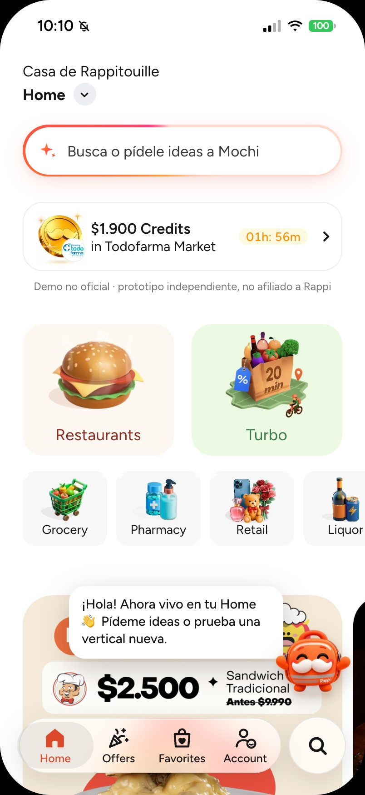
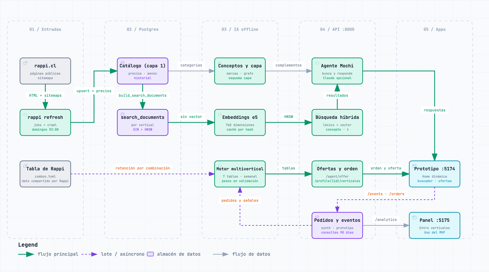

# rappi-dlab · Que Rappi se conozca más allá de una vertical

Propuesta para Rappi Chile: un **prototipo navegable de la app** en el que Mochi, la mochila de Rappi con bigote, vive en la Home, busca contigo y te invita a descubrir verticales que no usas. Detrás hay datos reales: el catálogo público de rappi.cl en Postgres + pgvector, una búsqueda híbrida evaluada y una capa de datos que entiende qué es cada producto.

> [!NOTE]
> Proyecto independiente: no está afiliado a Rappi ni cuenta con su respaldo. Rappi y las demás marcas mencionadas pertenecen a sus respectivos dueños.

[](https://github.com/yungzyx/rappi-dlab/actions/workflows/ci.yml)


*El prototipo final. El interruptor de arriba (tecla **D**) alterna con la app como es hoy.*

## El problema

Vista desde fuera, como usuarios de la app, cada vertical de Rappi parece funcionar como un silo: lo que una persona compra o busca en el supermercado no parece cambiar lo que se le recomienda en licores, farmacia o restaurantes. La hipótesis: muchas personas usan una o dos verticales y no llegan a las demás.

La señal existe: cada búsqueda y cada pedido dice algo de quien lo hace. Pero no se ve que cruce de una vertical a otra, y con ella se pueden perder venta cruzada y frecuencia. El proyecto no tiene acceso a datos internos: con ellos, Rappi puede confirmarlo o descartarlo. Detalle en [docs/contexto-y-problema.md](docs/contexto-y-problema.md).

## La propuesta

**Buscar dentro de la vertical, entender a través de las verticales, e invitar a descubrir las que la persona no usa.** El prototipo final lo muestra en dos piezas:

| Pieza | Qué hace |
|---|---|
| **Mochi en la Home** | Mochi de cuerpo entero vive en la Home, sin canal aparte para escribirle. Saluda, acompaña el plan del día («¿Qué plan tienes hoy?», un kit de varias verticales) y, al tocarlo, propone una vertical por probar. |
| **Buscador con Mochi** | La barra de la Home abre el buscador de siempre con lo que Mochi sabe de ti: lo aprendido (con «Olvidar»), ideas para tocar («Arma un carrete»), búsqueda de tiendas y productos y «Descubre con Mochi». Se toca; no se escribe. |

| La Home | El buscador con Mochi |
|:---:|:---:|
|  |  |

### Cómo cruza las verticales

La app busca en las verticales que corresponden a la consulta (las de su concepto o su ocasión, como «carrete»; sin ninguno, en todas, y quedan solo las que calzan las palabras o se parecen mucho) y muestra un grupo por vertical, con la de la pantalla primero. Los intereses se guardan como **conceptos** comunes a todas (cerveza, snacks salados, pañales…), y una recomendación cruzada sigue tres pasos: concepto → complemento → búsqueda en la otra vertical.

| Lo que hace la persona | Concepto | Complemento | Dónde se busca | Qué ve |
|---|---|---|---|---|
| Pide cerveza bajo $3.000 en Licores | cerveza | snacks salados | la vertical donde el concepto es más típico entre las que tienen oferta suficiente (Express) | «De Express · ¿Te tinca sumar snacks salados? Porque llevas cerveza», con «Ver más en Express» |
| Compra pañales en el supermercado | pañales | alimentación de bebé | la vertical donde ese concepto es más típico (farmacia), no la de más ítems | «De Farmacia · ¿Te tinca sumar alimentación de bebé? Porque llevas pañales» |

Las sugerencias siguen reglas para no perder la confianza del cliente: como máximo una sugerencia cruzada por respuesta y con su razón visible; nunca productos sensibles por iniciativa propia (medicamentos, salud sexual, tabaco y vapeo; Farmacia se puede jugar pero nunca se propone); Mochi nunca ofrece alcohol por su cuenta: solo aparece en el kit de una ocasión que la persona eligió, siempre con el aviso +18; y lo aprendido se ve y se borra («Olvidar»).

El efecto real (frecuencia, venta cruzada, verticales nuevas por persona) solo se puede medir con datos de Rappi y un experimento A/B con grupo de control.

## Cómo funciona



1. **Descarga (semanal).** `rappi refresh` lee las páginas públicas de rappi.cl y guarda catálogo, menús y precios con historial.
2. **Postgres + pgvector.** El catálogo (capa 1) y `search_documents`, una partición por vertical.
3. **IA offline.** Cada producto y plato recibe un concepto (capa 2), y los conceptos se enlazan con sus complementos. Una capa de datos suma atributos, medidas, marcas, un grafo de conocimiento y segmentos, y los expone en el esquema `capa` ([docs/capa-de-datos.md](docs/capa-de-datos.md)). Cada documento recibe un embedding de un modelo local multilingüe (e5), con un índice vectorial por vertical. Opcionalmente, y solo en este proceso semanal, Jev (el modelo «System One» de TypeSafe) etiqueta las categorías nuevas y suma un juez a la evaluación; viene apagado hasta que se ponga una clave y un piloto lo apruebe ([docs/jev.md](docs/jev.md)).
4. **Consulta.** Búsqueda híbrida por vertical (la app consulta las verticales de la consulta, las de su concepto o su ocasión, o todas si no detecta ninguno, y muestra un grupo por vertical): por palabras y por significado, combinadas por posición (RRF) y reforzadas por el concepto pedido. Mochi arma la respuesta y la sugerencia cruzada.
5. **Prototipo.** La API (FastAPI, puerto 8000) atiende al prototipo (5174). El prototipo no abre sin la API: muestra «Sin conexión con Mochi» (se levantan juntos con `make mvp`). Las verticales, las tiendas con sus pasillos, los restaurantes con su menú, Turbo, Ofertas, Favoritos y la Home leen el catálogo real de la API (`/catalog`); el buscador y Mochi (preguntas, kits, comentarios, «Para ti» y lo aprendido) también salen de la API, sin datos ni respuestas locales.

**Mochi** en la API responde solo por texto (`POST /agent/ask`); el prototipo lo usa como buscador. Su nombre visible sale de `AGENT_NAME` (rappi-ia) y de `prototipo-app/src/agent/name.js`. Reconoce servicios sin catálogo (un viaje lleva a **RappiTravel**, un envío o trámite a **RappiFavor**). Arma perfiles de gusto (el sushi abre «Amante de lo asiático») y ofrece lo de ese gusto en otras verticales, de a un peldaño; la API los sirve y la app todavía no los usa. Sin clave de API responde con plantillas; con clave, Claude solo redacta sobre lo que el código ya recuperó y verificó. Diseño completo: [docs/diseno-ia.md](docs/diseno-ia.md).

## Grafos y diagramas

| Qué | Para qué | Dónde |
|---|---|---|
| Mapa multivertical | Qué productos y conceptos comparten las verticales, con complementos, sustitutos y «nunca junto» | [docs/mapas/mapa-multivertical.html](docs/mapas/mapa-multivertical.html) (descargar y abrir; se regenera con `rappi-ia multivertical`) |
| Mapa de conceptos | Cada concepto junto a la vertical donde es más típico (la regla de Mochi) | [docs/mapas/mapa-conceptos.jpg](docs/mapas/mapa-conceptos.jpg) |
| Flujo de datos | Del catálogo a la respuesta de Mochi | [PNG](docs/diagramas/rag-datos.png) · [interactivo](docs/diagramas/rag-datos.html) |
| Arquitectura por carriles | Qué hace cada pieza de la IA | [PNG](docs/diagramas/arquitectura-ia.png) · [interactivo](docs/diagramas/arquitectura-ia.html) |
| Scraper | Cómo se descarga el catálogo | [PNG](docs/diagramas/scraper-flujo.png) · [interactivo](docs/diagramas/scraper-flujo.html) |
| Despliegue | El MVP en un servidor: Caddy con la puerta, la API, Postgres y los respaldos | [PNG](docs/diagramas/despliegue.png) · [interactivo](docs/diagramas/despliegue.html) |


## Resultados

Cada cifra dice qué tipo de dato es: real, evaluación automática, estimación o simulación.

| Ámbito | Métrica | Valor | Tipo de dato | Fuente |
|---|---|---|---|---|
| Catálogo | Documentos de búsqueda | 253.945: 84.024 productos, 165.623 platos y 4.298 tiendas | Real (catálogo público) | Base `rappi`, descarga del 04-10-2026 (contada el 05-10) |
| Catálogo | Documentos con embedding | 100 % (`intfloat/multilingual-e5-base`, 768 dim, HNSW por vertical) | Real | Base `rappi`, 04-10-2026 |
| Capa 2 | Taxonomía | 133 conceptos · 103 complementos curados · 818 categorías con mapeo revisado | Curado a mano; mapa de categorías generado con LLM y versionado | `make concepts`, 06-10-2026 |
| Capa 2 | Precisión de la asignación | 86 % por regla de nombre, 88 % por mapeo y 88 % por vecinos, en una muestra nueva tras corregir las reglas (antes: 81, 82 y 57 %) | **Estimación** con jueces LLM | [antes](docs/resultados/capas-precision-2026-10-06.md) · [después](docs/resultados/capas-precision-2026-10-06-nueva-muestra.md) |
| Capa de datos | Atributos, marcas y grafo | 83 atributos sobre 79.617 ítems · 6.359 marcas · 23.534 productos canónicos · 32.105 aristas en 12 relaciones | Real, con reglas propias; atributos 92 % y marcas 97 a 99 % de precisión estimada | `make layers`, 06-10-2026 |
| Búsqueda | nDCG@10 | híbrido 0,917 · sin refuerzo por concepto 0,860 · vectorial 0,849 · léxico 0,776 | Evaluación automática | [reporte del 06-10](docs/resultados/busqueda-2026-10-06.md) |
| Búsqueda | «Sin resultado» | precisión 1,00 (0 falsas alarmas) · recall 0,73 (30 de 41) | Evaluación automática | [reporte del 06-10](docs/resultados/busqueda-2026-10-06.md) |
| Calidad | Tests (11-10-2026) | scraper 262 · rappi-ia 1638 · prototipo 732 · panel 114 | Verificación local y CI | `make test` · `npm test` (conteo con `pytest --collect-only -q` y `npm test`) |

### Catálogo por vertical

| Vertical | Tiendas | Productos | Con concepto |
|---|---:|---:|---:|
| Supermercado | 320 | 29.403 | 99,8 % |
| Conveniencia | 38 | 7.848 | 100 % |
| Turbo | 18 | 2.642 | 100 % |
| Rappi Mall | 359 | 32.761 | 99,7 % |
| Farmacia | 16 | 4.726 | 99,8 % |
| Licores | 79 | 5.519 | 100 % |
| Chocolatería | 24 | 1.125 | 100 % |
| Restaurantes | 3.444 | 165.623 platos | 94,7 % |

Documentos al 04-10-2026 (segunda descarga semanal automática); «Con concepto», del 06-10. En tiendas es una muestra: la página pública muestra hasta 24 productos por sub-pasillo. Turbo quedó con los precios del 27-09 (ver [Límites](#límites)).

### Motor multivertical (datos simulados: prueban la mecánica, no el efecto)

Corrida del 16-10-2026 (`rappi-ia motor`) sobre una copia del catálogo real y **3.000 personas simuladas**, con tramos por fecha: entrenar, validar y probar (28 días cada uno de los dos últimos; 357 personas en la prueba). Informe completo y lectura en [docs/resultados/motor-2026-10-16.md](docs/resultados/motor-2026-10-16.md).

| Qué | Métrica | Valor | Tipo de dato |
|---|---|---|---|
| Próximo vertical | nDCG@8 | combinado 0,961 · solo afinidad 0,958 · popularidad 0,891 · orden fijo 0,883 | Simulado |
| Compra cruzada | precisión@3 | reglas aprendidas 0,076 (66 de 357 personas con alguna regla) · lo más pedido 0,124. **Las reglas aún no superan a lo más pedido** | Simulado |
| Recompra | acierto ±7 días | 0,158 sobre 76 predicciones (volvieron a comprar el 34 %; error mediano de 9 días) | Simulado |

El generador de datos simulados se calibró con la tabla de combinaciones de verticales y retención que **compartió el equipo de Rappi** (dato compartido por Rappi, cohortes de enero a junio de 2026): es una correlación, no un efecto, y el simulador la trata como efecto, así que sus cifras no prueban que sumar verticales retenga. La agrupación de verticales en `rest`, `turbo` y `retail` es un supuesto propio. Detalle: [docs/capa-de-datos.md](docs/capa-de-datos.md#motor-multivertical).

### Búsqueda

124 consultas positivas en las 8 verticales y 41 negativas, con relevancia juzgada automáticamente por concepto ([`queries.json`](rappi-ia/src/rappi_ia/eval/queries.json)). Por tipo de consulta, el híbrido logra 0,988 en las exactas, 0,973 sin tildes y 0,712 en necesidades en lenguaje natural («algo para el carrete»), frente a 0,563 del léxico. Detalle, por vertical y con la historia de cada reevaluación: [docs/resultados/](docs/resultados/).

> [!IMPORTANT]
> **Qué no es evidencia**
>
> - **Usuarios y eventos simulados.** Los segmentos y las métricas de negocio usan personas simuladas (`source = 'synthetic'`): muestran la mecánica, no un resultado.
> - **La ventaja del híbrido.** La relevancia se juzga por concepto y el híbrido recibe un refuerzo por ese mismo concepto; sin él, no se distingue del vectorial (0,860 frente a 0,849). Falta un juicio humano.
> - **Las precisiones de la capa 2 y de la capa de datos** son estimaciones con jueces LLM.
> - **Lo que Mochi aprende de la persona y sus pedidos** es de demo: se guardan en el servidor bajo un id seudónimo del navegador, sin cuenta; la persona los borra con «Borrar mis datos» (Cuenta).
> - **«No está en el catálogo»** no significa «Rappi no lo vende»: en tiendas el catálogo es una muestra.

## Probarlo

### El MVP (`make mvp`)

Un comando levanta la API de rappi-ia (:8000), la app (:5174) y el panel (:5175). **La app no corre sin la API:** si no responde, muestra «Sin conexión con Mochi» con un botón «Reintentar». Ya no hay una versión que funcione sola en el navegador.

Requisitos (el detalle, en [docs/instalacion.md](docs/instalacion.md)):

- Postgres con la base `rappi` cargada (ver «Con el catálogo real»).
- `make install` en `rappi-scraper/` y `make install install-ml` en `rappi-ia/`.
- `npm ci` en `prototipo-app/` y en `dashboard-empresa/` (Node 22.22+ o 24.15+).

```bash
make mvp          # desde la raíz del repositorio; Ctrl-C detiene los tres
make mvp LAN=1    # abre la API y la app a la red local, para el iPhone (solo en una red de confianza)
make mvp-check    # recorre el MVP con Chrome contra un catálogo inventado, sin tocar la base real (5 revisiones)
```

`make mvp` revisa las dependencias, los puertos y la base (`rappi-ia doctor`, solo lectura), aplica las migraciones pendientes (no las de una rama sin fusionar: `MIGRATE=1` lo fuerza, ver [docs/instalacion.md](docs/instalacion.md#5-el-mvp)), arranca los tres con sus registros prefijados y avisa cuando responden. La API tarda en estar lista porque carga los modelos. No descarga nada de rappi.cl. Qué revisa `make mvp-check`, en [docs/instalacion.md](docs/instalacion.md#5-el-mvp).

La tecla **D** (o Account → Settings → Modo demo en el celular) alterna «Prototipo final» y «Rappi hoy». Guion de demo: [docs/demo.md](docs/demo.md).

### Con el catálogo real

La API lee la base `rappi`, que se restaura desde un respaldo (o se descarga) y se deja al día con la capa de IA: ver [docs/instalacion.md](docs/instalacion.md), secciones 3 y 4. Con ella, Mochi busca en el catálogo real con precios vigentes. En local la API no tiene puerta de acceso (los datos de cada persona sí piden su token de sesión) y por defecto escucha solo en el equipo local (`make mvp LAN=1` y `make serve-lan` la abren a la red, solo en una red de confianza). `make schedule` en `rappi-scraper/` programa la actualización semanal (domingos 03:00) seguida de `make post-refresh` en rappi-ia.

### En un servidor

Una demo cerrada en un servidor Linux con Docker Compose: Caddy con TLS y una puerta de usuario y clave sobre todo el sitio, la API con identidad firmada y la base con roles separados, migraciones con respaldo y respaldos fuera del equipo. Paso a paso, en [docs/despliegue.md](docs/despliegue.md).

## Qué es real y qué es simulado

- **Real:** el catálogo, los precios y los menús (de rappi.cl), los conceptos, la capa de datos, la búsqueda y las respuestas de Mochi con la API. Las tiendas, productos, precios, menús y ofertas que muestran las pantallas del prototipo salen de la API; su diseño (títulos, categorías, banners) sigue siendo de recortes de capturas de la app. Lo que la API no sabe (tiempo de entrega, nota, costo de envío) no se muestra.
- **Simulado:** el pago, el seguimiento del pedido (llega a los 20 s), y los usuarios y eventos para segmentos y métricas.
- **Uso responsable:** solo páginas públicas sin barreras técnicas, sin APIs internas ni inicio de sesión, una descarga a la vez con pausas de 1,5 a 3 s y una actualización por semana. Sin datos personales: los usuarios son simulados o del prototipo (id seudónimo). Los datos descargados no se publican ni están en el repositorio. Fines de investigación y demostración; un uso comercial requeriría autorización de Rappi.

## Límites

- **Cobertura parcial en tiendas:** hasta 24 productos por sub-pasillo y una sucursal por marca o formato. No se listan las tiendas sin ofertas vigentes en un pasillo de primer nivel, ni Mascotas (la base no tiene esa vertical).
- **Mochi no ofrece por su cuenta alcohol, farmacia, bebé ni salud:** solo el kit de una ocasión que la persona elige puede traer alcohol, con +18. Consecuencia aceptada: hay menos complementos (por ejemplo, «playa» ya no sugiere protector solar). Ver [docs/decisiones.md](docs/decisiones.md).
- **Turbo sin actualizar:** sus tiendas ya no aparecen como Turbo en los listados públicos que recorre el scraper; sus precios son del 27-09.
- **Evaluación automática:** no hay juicio humano, y el refuerzo por concepto favorece al híbrido.
- **«Sin resultado»:** detecta 30 de 41 negativas; el reporte explica las demás.
- **Demo cerrada:** sin cuentas ni lanzamiento abierto. En local la API no tiene puerta de acceso y la instalación está pensada para macOS (Homebrew, launchd); en un servidor, todo el sitio va detrás de usuario y clave.
- **Cambios del sitio:** si rappi.cl cambia su frontend, hay que ajustar los parsers; el reporte de cada corrida marca las respuestas anómalas.

## Estructura del repositorio

```text
.
├── prototipo-app/          el prototipo final (Vite + React): Mochi y buscador con Mochi
├── rappi-ia/               conceptos, embeddings, búsqueda, capa de datos, Mochi y API (comando `rappi-ia`)
├── rappi-scraper/          descarga del catálogo público → Postgres + pgvector (comando `rappi`; migraciones de toda la base)
├── dashboard-empresa/      panel de negocio, parte del MVP (Vite + React; lee la API)
├── docs/                   propuesta, diseño, decisiones, demo, instalación y resultados
│   ├── diagramas/          diagramas (PNG e interactivos) y sus fuentes en diagramas-fuente/
│   ├── mapas/              mapa multivertical y mapa de conceptos
│   └── resultados/         reportes de evaluación versionados (fuente de las cifras)
├── deploy/                 despliegue en un servidor: compose, Caddy, Dockerfiles, roles de la base, respaldos y timers
├── Makefile, scripts/      `make mvp` y `make mvp-check`: levantan y recorren el MVP
├── .github/workflows/      CI (scraper y rappi-ia contra Postgres + pgvector; prototipo y panel con lint, tests y build; `make mvp-check`, los scripts y el stack de Docker)
└── CLAUDE.md               convenciones para asistentes de código
```

**Fuera del repositorio:** la base Postgres `rappi`, `rappi-scraper/data/` y `rappi-ia/data/`. Los datos descargados no se versionan.

## Panel de negocio

[`dashboard-empresa/`](dashboard-empresa/) es el panel para la empresa y forma parte del MVP: lee las métricas de la API (`/analytics`) y `make mvp` lo levanta junto a la app. Convierte la conducta de compra y lo que la gente pide en decisiones (tendencias por concepto, demanda no satisfecha, usuarios en riesgo, rendimiento de las sugerencias cruzadas y salud del catálogo). Se elige la fuente de los datos y nunca se mezclan:

- **Simulados** (por defecto): usuarios, eventos y pedidos de un generador con semilla. Muestran la mecánica del panel, no un resultado. La pestaña Catálogo es real (muestra pública de rappi.cl).
- **Prototipo**: lo que la gente hizo en la app del MVP, con la vista **Uso del MVP**: las ofertas del agente por momento (plan, carro, antes de pagar, próximo pedido, sin resultado, vertical por probar, pregunta y «Para ti») y las búsquedas sin resultado por vertical y concepto. Es uso de pocas personas y el panel lo rotula «uso del MVP, pocas personas: no es evidencia». Sin nombres ni textos: personas contadas, nunca nombradas.

```bash
make mvp   # panel en http://localhost:5175/?vista=mvp&fuente=prototipo (sin la API, «Uso del MVP» no muestra cifras: dice «La API no responde»)
```

## Historial del proyecto

Este repo cuenta la propuesta vigente. Todas las etapas anteriores (la presentación al gerente, las versiones con Bigotes, los modos «Propuesta» y «Bigotes vivo») y el pasaporte con el juego de verticales (código, tarjetas y planes) están en [**rappi-evolucion-proyecto**](https://github.com/yungzyx/rappi-evolucion-proyecto), con una etiqueta por etapa y su [línea de tiempo](https://github.com/yungzyx/rappi-evolucion-proyecto/blob/main/EVOLUCION.md).

## Documentación

Índice, con qué leer según lo que buscas: [docs/README.md](docs/README.md). Decisiones con su porqué: [docs/decisiones.md](docs/decisiones.md).

## Autor

[yungzyx](https://github.com/yungzyx). Desarrollo asistido por IA (Claude Code).

Repositorio privado y sin licencia de código abierto: incluye capturas y material de terceros.
