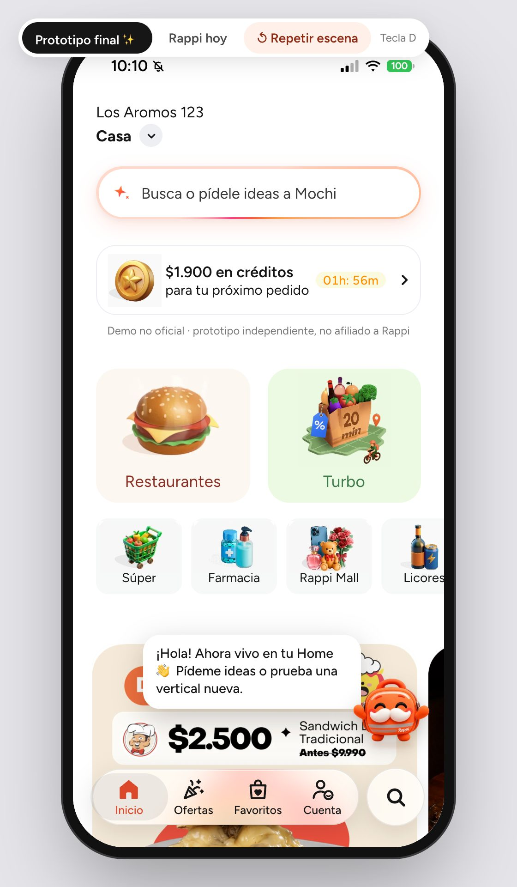
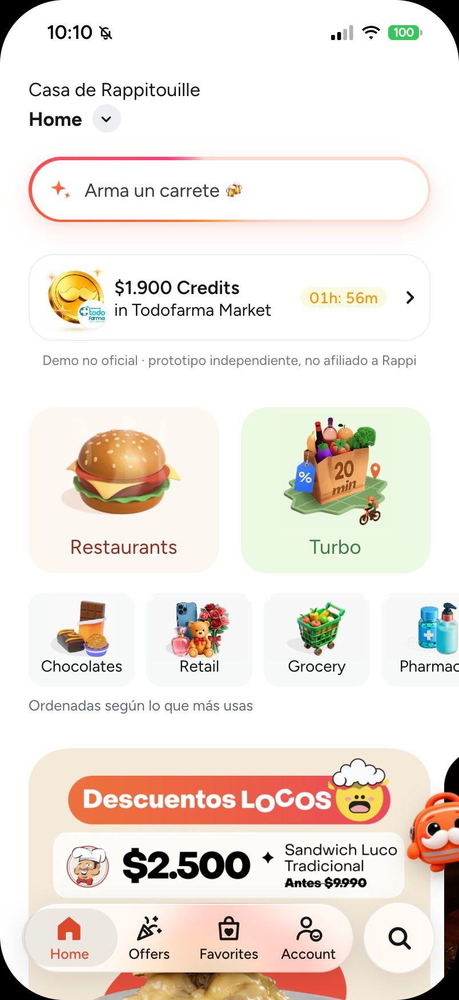
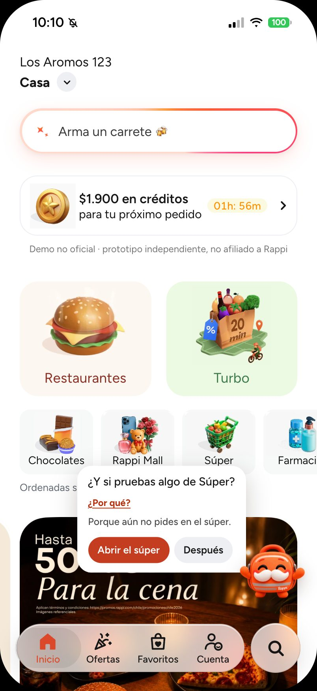
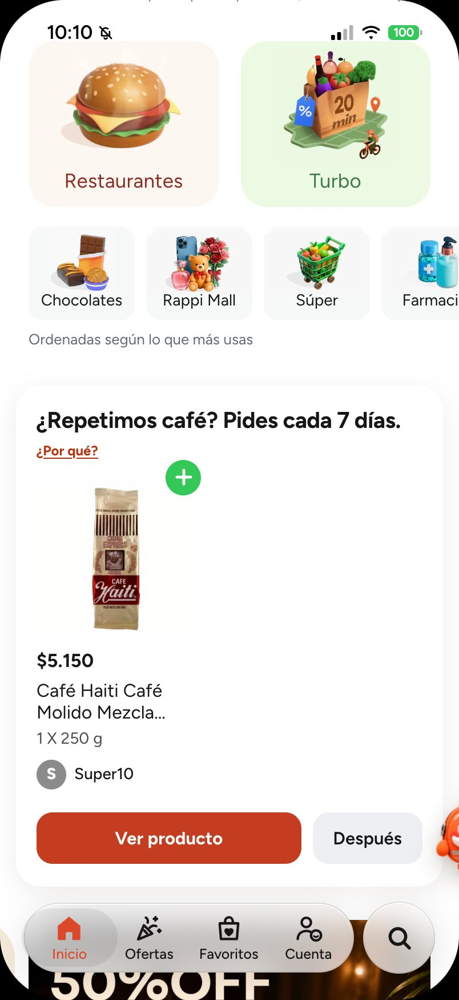
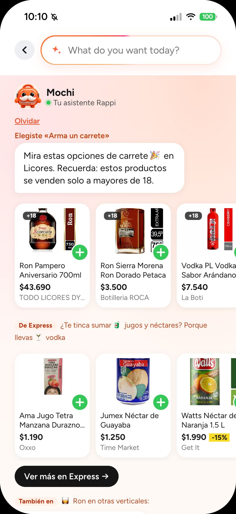
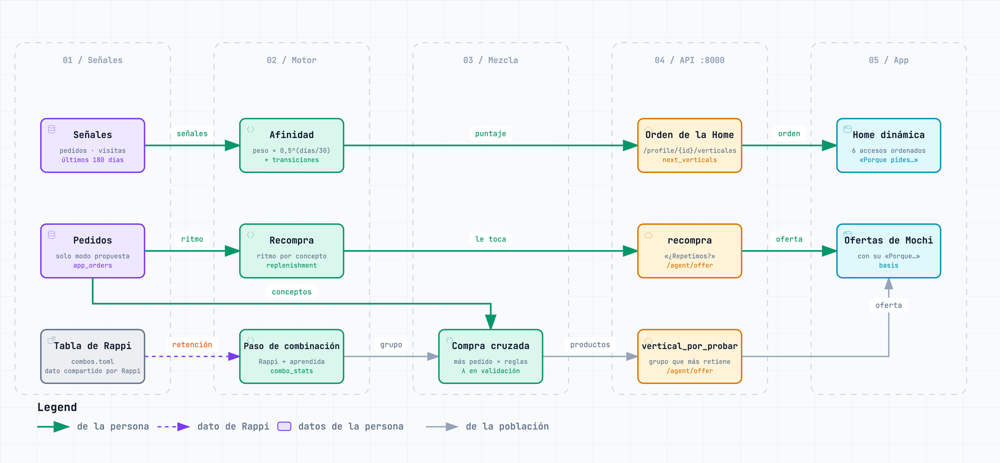

# rappi-dlab · Un motor que conecta las verticales de Rappi

Propuesta para Rappi Chile: un **motor multivertical** en la base de datos que aprende, de cada persona y de la población, qué verticales usa, cuál conviene sumarle y qué le toca pedir de nuevo. Un **prototipo navegable de la app** lo muestra: la Home ordena sus accesos según el uso de cada persona y Mochi, la mochila de Rappi con bigote, propone la siguiente vertical siguiendo la escalera Restaurantes → Turbo → Retail, que parte de la tabla de combinaciones que compartió el equipo de Rappi. Detrás hay datos reales: el catálogo público de rappi.cl en Postgres + pgvector, una búsqueda híbrida evaluada y una capa de datos que entiende qué es cada producto.

> [!NOTE]
> Proyecto independiente: no está afiliado a Rappi ni cuenta con su respaldo. Rappi y las demás marcas mencionadas pertenecen a sus respectivos dueños.

[](https://github.com/yungzyx/rappi-dlab/actions/workflows/ci.yml)



*El prototipo final. El interruptor de arriba (tecla **D**) alterna con la app como es hoy.*

## El problema

Vista desde fuera, como usuarios de la app, cada vertical de Rappi parece funcionar como un silo: lo que una persona compra o busca en el supermercado no parece cambiar lo que se le recomienda en licores, farmacia o restaurantes. La hipótesis: muchas personas usan una o dos verticales y no llegan a las demás.

La tabla que compartió el equipo de Rappi apunta en esa dirección. La mayoría usa una sola vertical en el mes, y quienes combinan más vuelven más al mes siguiente:

| Verticales usadas en el mes | % de usuarios | Pedidos por usuario | Vuelven al mes siguiente |
|---|---:|---:|---:|
| Solo Restaurantes | 62,6 % | 1,9 | 47 % |
| Restaurantes + Turbo | 6,6 % | 5,5 | 82 % |
| Restaurantes + Retail | 5,4 % | 4,7 | 76 % |
| Restaurantes + Turbo + Retail | 4,7 % | 10,5 | 93 % |
| Todo Chile | 100 % | 3,0 | 55 % |

*Dato compartido por Rappi: cohortes de enero a junio de 2026, agrupación gruesa de verticales. Tabla completa en la [especificación del motor](docs/superpowers/specs/2026-10-16-motor-multivertical-design.md#3-dato-de-partida-chile--verticals-used-together).*

Es una **correlación, no un efecto**: quien ya pide mucho usa más verticales y además vuelve más. No prueba que sumarle una vertical a alguien lo retenga; eso solo lo mide un experimento A/B con grupo de control. Más contexto en [docs/contexto-y-problema.md](docs/contexto-y-problema.md).

## La propuesta

**Buscar dentro de la vertical, entender a través de las verticales, e invitar a descubrir las que la persona no usa.**

- **Buscar dentro de la vertical:** la búsqueda responde en las verticales que corresponden a la consulta y muestra un grupo por vertical, sin mezclar sus índices.
- **Entender a través de las verticales:** los intereses se guardan como conceptos comunes a todas (cerveza, snacks salados, pañales…), y el motor suma lo que la persona hace en cada vertical.
- **Invitar a descubrir:** la tabla de Rappi es el punto de partida para elegir qué vertical sumar. Quien pide en Restaurantes ve primero Turbo; quien ya combina esas dos, Retail. El motor lo mezcla con lo que aprende de la población (hoy simulada) y cada sugerencia dice por qué.

### Lo que está construido

| Pieza | Qué hace |
|---|---|
| **Motor multivertical** | En la base de datos, siete tablas con vistas estables en el esquema `capa`. Guarda la afinidad de cada persona por cada vertical, las transiciones entre verticales y las combinaciones con su retención (la tabla de Rappi medida con los datos propios). Suma la compra cruzada entre verticales, lo más pedido y lo que sube, y la recompra (qué concepto pide cada persona con ritmo y cuándo le toca). Se evalúa por fechas (entrenar, validar, probar) y elige sus pesos en validación. Lo personal sale de los datos de cada persona; lo de la población, de una fuente declarada en cada oferta (hoy, personas simuladas). |
| **Home que aprende el orden** | Los seis accesos pequeños de la Home (Grocery, Pharmacy, Retail, Liquor, Express, Chocolates) se ordenan según lo que cada persona pide y abre, con la leyenda «Ordenadas según lo que más usas». Quien no tiene historial ve el orden fijo. Restaurantes y Turbo no se mueven, Loyalty y Benefits Pro quedan siempre al final y «Rappi hoy» no aprende. Nace de una conversación con el equipo de Rappi. |
| **Mochi en la Home, con recomendaciones conectadas** | Mochi de cuerpo entero vive en la Home, sin un canal aparte para escribirle. Saluda, acompaña el plan del día («¿Qué plan tienes hoy?», un kit de varias verticales) y, al tocarlo, propone la siguiente vertical de la escalera con su porqué. Dentro de esa vertical ofrece lo más pedido ahí; cuando una regla aprendida lo justifica (hoy no, λ = 0), lo que suelen sumar quienes piden lo mismo. Cuando a la persona le toca, propone repetir («¿Repetimos …? Pides cada N días.»). |
| **Buscador con Mochi** | La barra de la Home abre el buscador de siempre con lo que Mochi sabe de la persona: lo aprendido (con «Olvidar»), ideas para tocar («Arma un carrete»), búsqueda de tiendas y productos, y «Descubre con Mochi». Se toca; no se escribe. |

| La Home que aprende | Mochi propone una vertical | «¿Repetimos?» | El buscador con Mochi |
|:---:|:---:|:---:|:---:|
|  |  |  |  |
| Alguien abrió dos veces Chocolates y una vez Retail: esos accesos suben. | Esa persona solo abrió accesos y nunca pidió: Mochi le propone el súper y dice por qué. | Ejemplo armado con la respuesta de muestra de la API y un café real del catálogo; no es un hábito medido. | «Arma un carrete» junta productos y tiendas para la ocasión. |

### Cómo cruza las verticales

Una recomendación cruzada sigue tres pasos: concepto → complemento → búsqueda en la otra vertical. Algunos ejemplos:

| Lo que hace la persona | Concepto | Complemento | Dónde se busca | Qué ve |
|---|---|---|---|---|
| Pide cerveza bajo $3.000 en Licores | cerveza | snacks salados | la vertical donde el concepto es más típico entre las que tienen oferta suficiente, sin contar la actual (Express) | «De Express ¿Te tinca sumar 🥨 snacks salados? Porque llevas 🍺 cerveza», con «Ver más en Express →» |
| Pide pizza en Restaurantes | pizza | bebidas gaseosas (su primer complemento, la cerveza, Mochi no lo ofrece) | Express (Licores no se ofrece) | «De Express ¿Te tinca sumar 🥤 bebidas gaseosas? Porque llevas 🍕 pizza» |
| Busca pañales | pañales | — | — | Ninguna sugerencia: sus complementos son de bebé y salud, que Mochi nunca ofrece por su cuenta |

**La escalera.** Para elegir qué vertical sumarle a cada persona, el motor parte de la tabla de Rappi y la mezcla con la retención aprendida de la población. Dentro de la vertical elegida, la compra cruzada mezcla lo más pedido con las reglas aprendidas («quien pide A en una vertical pide B en otra»), con un peso λ que se elige en validación (hoy quedó en 0, así que se ofrece lo más pedido). Si la persona compra una marca, esa marca gana a la combinación en un empate. Cada oferta dice en su `basis` de qué fuente salió, y el texto no afirma lo que hace la población («Porque pides …. Para acompañar: …, en ….»).

Las sugerencias siguen reglas para no perder la confianza del cliente: como máximo una sugerencia cruzada por respuesta, con su razón visible; nunca productos sensibles por iniciativa propia (medicamentos, salud sexual, tabaco y vapeo). Farmacia y Licores solo suben en la Home por señales de la propia persona y nunca se proponen por iniciativa propia. Mochi nunca ofrece alcohol por su cuenta: solo aparece en el kit de una ocasión que la persona eligió, siempre con el aviso +18. Lo aprendido se ve y se borra («Olvidar»).

## Cómo funciona



*El motor: lo de la persona (verde) ordena la Home y decide la recompra; la tabla de Rappi (punteada) y lo aprendido de la población (gris) eligen la vertical por probar y sus productos. [Versión interactiva](docs/diagramas/motor-flujo.html).*

1. **Descarga (semanal).** `rappi refresh` lee las páginas públicas de rappi.cl y guarda catálogo, menús y precios con historial.
2. **Postgres + pgvector.** El catálogo (capa 1) y `search_documents`, una partición por vertical.
3. **IA offline.** Cada producto y plato recibe un concepto (capa 2), y los conceptos se enlazan con sus complementos. Una capa de datos suma atributos, medidas, marcas, un grafo de conocimiento y segmentos, y al final el **motor multivertical** (`make layers`, también dentro de `make post-refresh`), todo expuesto en el esquema `capa` ([docs/capa-de-datos.md](docs/capa-de-datos.md#motor-multivertical)). Cada documento recibe un embedding de un modelo local multilingüe (e5), con un índice vectorial por vertical. Opcionalmente, y solo en este proceso semanal, Jev (el modelo «System One» de TypeSafe) etiqueta las categorías nuevas y suma un juez a la evaluación; viene apagado hasta que se ponga una clave y un piloto lo apruebe ([docs/jev.md](docs/jev.md)).
4. **Consulta.** Búsqueda híbrida por vertical: por palabras y por significado, combinadas por posición (RRF) y reforzadas por el concepto pedido. Mochi arma la respuesta y la sugerencia cruzada.
5. **API y prototipo.** La API (FastAPI, puerto 8000) atiende al prototipo (5174) y al panel (5175). El orden de la Home sale de `GET /profile/{id}/verticales` y las ofertas de Mochi de `POST /agent/offer` (vertical por probar, recompra, carro, próximo pedido…). Después de cada pedido, la API recalcula la afinidad y la recompra de esa persona. Las verticales, las tiendas con sus pasillos, los restaurantes con su menú, Turbo, Ofertas y Favoritos leen el catálogo real (`/catalog`). El prototipo no abre sin la API: muestra «Sin conexión con Mochi».


**Mochi** en la API responde solo por texto (`POST /agent/ask`); el prototipo lo usa como buscador y con ofertas. Su nombre visible sale de `AGENT_NAME` (rappi-ia) y de `prototipo-app/src/agent/name.js`. Reconoce servicios sin catálogo (un viaje lleva a **RappiTravel**, un envío o trámite a **RappiFavor**). También arma perfiles de gusto (el sushi abre «Amante de lo asiático») y ofrece lo de ese gusto en otras verticales, de a un peldaño; la API los sirve y la app todavía no los usa. Sin clave de API responde con plantillas; con clave, Claude solo redacta sobre lo que el código ya recuperó y verificó. Diseño completo: [docs/diseno-ia.md](docs/diseno-ia.md).

## Grafos y diagramas

| Qué | Para qué | Dónde |
|---|---|---|
| Motor multivertical | De las señales y pedidos de la persona, y de la tabla de Rappi, a la Home dinámica y las ofertas de Mochi | [PNG](docs/diagramas/motor-flujo.png) · [interactivo](docs/diagramas/motor-flujo.html) |
| Flujo de datos | Del catálogo a la respuesta de Mochi, con el motor | [PNG](docs/diagramas/rag-datos.png) · [interactivo](docs/diagramas/rag-datos.html) |
| Arquitectura por carriles | Qué hace cada pieza de la IA | [PNG](docs/diagramas/arquitectura-ia.png) · [interactivo](docs/diagramas/arquitectura-ia.html) |
| Mapa multivertical | Qué productos y conceptos comparten las verticales, con complementos, sustitutos y «nunca junto» | [docs/mapas/mapa-multivertical.html](docs/mapas/mapa-multivertical.html) (descargar y abrir; se regenera con `rappi-ia multivertical`) |
| Mapa de conceptos | Cada concepto junto a la vertical donde es más típico (la regla de Mochi) | [docs/mapas/mapa-conceptos.jpg](docs/mapas/mapa-conceptos.jpg) |
| Scraper | Cómo se descarga el catálogo | [PNG](docs/diagramas/scraper-flujo.png) · [interactivo](docs/diagramas/scraper-flujo.html) |
| Despliegue | El MVP en un servidor: Caddy con la puerta, la API, Postgres y los respaldos | [PNG](docs/diagramas/despliegue.png) · [interactivo](docs/diagramas/despliegue.html) |

## Resultados

Cada cifra dice qué tipo de dato es: real, evaluación automática, estimación, simulación o dato compartido por Rappi.

### Motor multivertical (datos simulados: prueban la mecánica, no el efecto)

Corrida del 17-10-2026 (`rappi-ia motor`, semilla 7) sobre una copia del catálogo real y **3.000 personas simuladas**, con el generador recalibrado a la mezcla de la tabla de Rappi y tramos por fecha: entrenar, validar y probar (28 días cada uno de los dos últimos). Cambiar el generador mueve todas las cifras simuladas; no son mejoras del motor. Antes y después, tolerancias y semillas: [docs/resultados/simulados-2026-10-17.md](docs/resultados/simulados-2026-10-17.md). La historia de la etapa 5 (intentos descartados y ruido entre semillas) y de la escalera fina: [docs/resultados/motor-2026-10-16.md](docs/resultados/motor-2026-10-16.md).

| Qué | Métrica (tramo de prueba) | Valor | Tipo de dato |
|---|---|---|---|
| Próxima vertical | nDCG@8 | combinado 0,978 · solo afinidad 0,976 · popularidad 0,924 · orden fijo 0,918 (477 personas) | Simulado |
| Compra cruzada | precisión@3 | mezcla 0,129 · lo más pedido 0,129. En validación λ quedó en 0, así que hoy las reglas no cambian lo que se ofrece; las reglas solas, 0,030 en 134 personas | Simulado |
| Recompra | acierto ±7 días | 0,191 (de 110 predicciones), error mediano de 6 días | Simulado |
| Generador simulado | parecido a la tabla de Rappi (personas-mes) | distancia 23,3 → 18,2 (16-10, Turbo en las sugerencias) → 2,9 (17-10, recalibrado; 2,5 a 5,5 en 5 semillas, cada fila a menos de 2 puntos). Retención M+1 de Restaurantes 0,452 (Rappi 0,47); rest+turbo+retail, la más alta (0,916; Rappi 0,93) | Simulado, comparado con el dato compartido por Rappi |
| Paso de la escalera fina | acierto@1 entre quienes suman una vertical | paso 0,620 · la vertical que más se suma 0,479 (71 personas). El paso busca retención, no adivinar qué se suma solo; con el generador del 16-10 perdía (0,466 contra 0,638): con 71 personas de una semilla, ninguna de las dos es evidencia | Simulado: no es evidencia |

Cómo leerlo: la ventaja del combinado viene casi entera de la afinidad de cada persona, y el generador hace que cada persona repita sus verticales, así que en parte acierta por construcción; con el generador recalibrado hay más personas que solo piden en Restaurantes, y eso facilita adivinar la próxima vertical a todos los métodos, incluido el orden fijo. El generador se calibró con la tabla de Rappi y la trata como efecto, así que sus cifras no prueban que sumar verticales retenga. La agrupación de verticales en `rest`, `turbo` y `retail` es un supuesto propio. Detalle: [docs/capa-de-datos.md](docs/capa-de-datos.md#motor-multivertical).

**Revisión sobre el catálogo real** ([QA del 16-10-2026](docs/resultados/qa-motor-2026-10-16.md), en solo lectura, con 200 personas simuladas y las 44 del prototipo, medida antes de los ajustes de la etapa 5, con λ > 0): las guardias (Farmacia, Licores, bebé, salud, conceptos sensibles, alcohol) dieron **0 casos en 2.851 productos ofrecidos**, y la ruta más lenta (`/recommendations`) respondió con p95 de 222 ms con el modelo de texto.

### Catálogo, conceptos y búsqueda

| Ámbito | Métrica | Valor | Tipo de dato | Fuente |
|---|---|---|---|---|
| Catálogo | Documentos de búsqueda | 253.945: 84.024 productos, 165.623 platos y 4.298 tiendas | Real (catálogo público) | Base `rappi`, descarga del 04-10-2026 (contada el 05-10) |
| Catálogo | Documentos con embedding | 100 % (`intfloat/multilingual-e5-base`, 768 dim, HNSW por vertical) | Real | Base `rappi`, 04-10-2026 |
| Capa 2 | Taxonomía | 136 conceptos (116 tipos de producto en 20 grupos) · 240 complementos curados (cada concepto que Mochi puede ofrecer tiene al menos dos) · 900 categorías, secciones de menú y cocinas con mapeo revisado | Curado a mano; mapa de categorías generado con LLM y versionado | `taxonomy.toml`, `complements.toml` y `category_map.csv`, contados el 16-10-2026 |
| Capa 2 | Precisión de la asignación | 86 % por regla de nombre, 88 % por mapeo y 88 % por vecinos, en una muestra nueva tras corregir las reglas (antes: 81, 82 y 57 %) | **Estimación** con jueces LLM | [antes](docs/resultados/capas-precision-2026-10-06.md) · [después](docs/resultados/capas-precision-2026-10-06-nueva-muestra.md) |
| Capa de datos | Atributos, marcas y grafo | 83 atributos sobre 79.617 ítems · 6.359 marcas · 23.534 productos canónicos · 32.105 aristas en 12 relaciones | Real, con reglas propias; atributos 92 % y marcas 97 a 99 % de precisión estimada | `make layers`, 06-10-2026 |
| Búsqueda | nDCG@10 | híbrido 0,905 · sin refuerzo por concepto 0,842 · vectorial 0,835 · léxico 0,765, con el set renovado el 22-10 (con el anterior, el híbrido daba 0,917; la regla nueva de «sin resultado» no lo cambia) | Evaluación automática | [reporte del 22-10](docs/resultados/busqueda-2026-10-22.md) |
| Búsqueda | «Sin resultado» | precisión 1,00 (0 falsas alarmas en 131 positivas) · recall 0,93 (54 de 58). Con el mismo set y la regla anterior, 36 de 58 (0,62) | Evaluación automática | [reporte del 22-10](docs/resultados/busqueda-2026-10-22.md) |
| Búsqueda | Errores de tipeo | 52 de 53 recuperados corrigiendo la consulta (29 sin corregir), en las 8 verticales; «sin resultado» y nDCG@10 iguales a los de arriba | Evaluación automática | [reporte del 24-10](docs/resultados/busqueda-2026-10-24.md) |
| Calidad | Tests (16-10-2026) | rappi-ia 2.416 · scraper 271 · prototipo 600 · panel 129 | Verificación local y CI | `make test` · `npm test` |

La búsqueda se evaluó con 131 consultas positivas en las 8 verticales y 58 negativas, con relevancia juzgada automáticamente por concepto ([`queries.json`](rappi-ia/src/rappi_ia/eval/queries.json), renovado el 22-10 contra el catálogo). Por tipo de consulta, el híbrido logra 0,970 en las exactas, 0,972 sin tildes y 0,709 en necesidades en lenguaje natural («algo para el carrete»), frente a 0,565 del léxico. Desde el 22-10, una consulta que no nombra concepto ni ocasión y no calza todas sus palabras necesita un coseno de 0,85 para mostrar algo («sofá de tres cuerpos» en Turbo ya no trae pisco Tres Erres); el costo eran errores de tipeo sin concepto, como «cervezaaaa». Desde el 24-10, si nada calza todas las palabras, la búsqueda corrige la consulta con el vocabulario del catálogo y vuelve a buscar, y lo corregido se muestra solo si calza todas sus palabras: de 53 errores de tipeo ([`typos.json`](rappi-ia/src/rappi_ia/eval/typos.json)) se recuperan 52, y las negativas y el nDCG no cambian ([reporte del 24-10](docs/resultados/busqueda-2026-10-24.md)). Salvedad: 0,85 se calibró con estas mismas negativas (la más alta llega a 0,847), 20 de ellas se sumaron junto con la regla y las positivas sin concepto ni ocasión calzan todas sus palabras, así que no miden el costo; ese se midió aparte, en un barrido de frases de usuarios ([decisiones, 22-10](docs/decisiones.md)). Detalle por vertical y con la historia de cada reevaluación: [docs/resultados/](docs/resultados/).

### Catálogo por vertical

| Vertical | Tiendas | Productos | Con concepto |
|---|---:|---:|---:|
| Supermercado | 320 | 29.403 | 99,8 % |
| Conveniencia | 38 | 7.848 | 100 % |
| Turbo | 18 | 2.642 | 100 % |
| Rappi Mall | 359 | 32.761 | 99,7 % |
| Farmacia | 16 | 4.726 | 99,8 % |
| Licores | 79 | 5.519 | 100 % |
| Chocolatería | 24 | 1.125 | 100 % |
| Restaurantes | 3.444 | 165.623 platos | 94,7 % |

Documentos al 04-10-2026 (segunda descarga semanal automática); «Con concepto», del 06-10. En tiendas es una muestra: la página pública muestra hasta 24 productos por sub-pasillo. Turbo quedó con los precios del 27-09 (ver [Límites](#límites)).

> [!IMPORTANT]
> **Qué no es evidencia**
>
> - **Usuarios y eventos simulados.** El motor, los segmentos y las métricas de negocio usan personas simuladas (`source = 'synthetic'`): muestran la mecánica, no un resultado.
> - **La tabla de Rappi** es una correlación: no dice que sumar una vertical retenga.
> - **La ventaja del híbrido.** La relevancia se juzga por concepto y el híbrido recibe un refuerzo por ese mismo concepto; sin él, no se distingue del vectorial (0,860 frente a 0,849). Falta un juicio humano.
> - **Las precisiones de la capa 2 y de la capa de datos** son estimaciones con jueces LLM.
> - **Lo que Mochi aprende de la persona y sus pedidos** es de demo: se guardan en el servidor bajo un id seudónimo del navegador, sin cuenta; la persona los borra con «Borrar mis datos» (Cuenta).
> - **«No está en el catálogo»** no significa «Rappi no lo vende»: en tiendas el catálogo es una muestra.

## Probarlo

### El MVP (`make mvp`)

Un comando levanta la API de rappi-ia (:8000), la app (:5174) y el panel (:5175). **La app no corre sin la API:** si no responde, muestra «Sin conexión con Mochi» con un botón «Reintentar».

Requisitos (el detalle, en [docs/instalacion.md](docs/instalacion.md)):

- Postgres con la base `rappi` cargada (ver «Con el catálogo real»).
- `make install` en `rappi-scraper/` y `make install install-ml` en `rappi-ia/`.
- `npm ci` en `prototipo-app/` y en `dashboard-empresa/` (Node 22.22+ o 24.15+).

```bash
make mvp          # desde la raíz del repositorio; Ctrl-C detiene los tres
make mvp LAN=1    # abre la API y la app a la red local, para el iPhone (solo en una red de confianza)
make mvp-check    # recorre el MVP con Chrome contra un catálogo inventado, sin tocar la base real (7 revisiones)
```

`make mvp` revisa las dependencias, los puertos y la base (`rappi-ia doctor`, solo lectura), aplica las migraciones pendientes (no las de una rama sin fusionar: `MIGRATE=1` lo fuerza, ver [docs/instalacion.md](docs/instalacion.md#5-el-mvp)), arranca los tres con sus registros prefijados y avisa cuando responden. La API tarda en estar lista porque carga los modelos. No descarga nada de rappi.cl. Qué revisa `make mvp-check` (entre otras cosas, la Home dinámica y la combinación), en [docs/instalacion.md](docs/instalacion.md#5-el-mvp).

La tecla **D** (o Account → Settings → Modo demo en el celular) alterna «Prototipo final» y «Rappi hoy». Guion de demo, con la Home que aprende y la escalera: [docs/demo.md](docs/demo.md).

### Con el catálogo real

La API lee la base `rappi`, que se restaura desde un respaldo (o se descarga) y se deja al día con la capa de IA y el motor: ver [docs/instalacion.md](docs/instalacion.md), secciones 3 y 4. Con ella, Mochi busca en el catálogo real con precios vigentes. En local la API no tiene puerta de acceso (los datos de cada persona sí piden su token de sesión) y por defecto escucha solo en el equipo local (`make mvp LAN=1` y `make serve-lan` la abren a la red, solo en una red de confianza). `make schedule` en `rappi-scraper/` programa la actualización semanal (domingos 03:00) seguida de `make post-refresh` en rappi-ia.

### En un servidor

Una demo cerrada en un servidor Linux con Docker Compose: Caddy con TLS y una puerta de usuario y clave sobre todo el sitio, la API con identidad firmada y la base con roles separados, migraciones con respaldo y respaldos fuera del equipo. Paso a paso, en [docs/despliegue.md](docs/despliegue.md).

## Qué es real y qué es simulado

- **Real:** el catálogo, los precios y los menús (de rappi.cl), los conceptos, la capa de datos, la búsqueda y las respuestas de Mochi con la API. Las tiendas, productos, precios, menús y ofertas que muestran las pantallas del prototipo salen de la API; su diseño (títulos, categorías, banners) sigue siendo de recortes de capturas de la app. Lo que la API no sabe (tiempo de entrega, nota, costo de envío) no se muestra.
- **Simulado:** el pago, el seguimiento del pedido (llega a los 20 s) y las personas, eventos y pedidos de los que el motor aprende la población y con los que se calculan segmentos y métricas.
- **Compartido por Rappi:** la tabla de combinaciones de verticales y su retención (cohortes de enero a junio de 2026), en `rappi-ia/src/rappi_ia/motor/combos.toml`. Es una correlación, no un efecto.
- **Uso del MVP:** lo que hicieron en la app las pocas personas que la probaron (`source = 'prototype'`). El panel lo rotula «uso del MVP, pocas personas: no es evidencia».
- **Uso responsable:** solo páginas públicas sin barreras técnicas, sin APIs internas ni inicio de sesión, una descarga a la vez con pausas de 1,5 a 3 s y una actualización por semana. Sin datos personales: los usuarios son simulados o del prototipo (id seudónimo). Los datos descargados no se publican ni están en el repositorio. Fines de investigación y demostración; un uso comercial requeriría autorización de Rappi.

## Límites

- **El motor aprende de una población simulada:** sin pedidos reales, las transiciones, las combinaciones, la compra cruzada y lo más pedido salen de personas simuladas (`MOTOR_POBLACION`; con datos de Rappi se cambia la fuente, no el mecanismo). Como en validación λ quedó en 0, la razón «Porque pides …. Para acompañar: …» no aparece en la demo: Mochi ofrece lo más pedido («Porque aún no pides en …: esto es lo que más se pide.»). Ver [docs/decisiones.md](docs/decisiones.md).
- **La escalera parte de una correlación:** la tabla de Rappi no prueba que sumar una vertical retenga, y la agrupación en `rest`, `turbo` y `retail` es un supuesto propio. El efecto (frecuencia, retención, verticales por persona) solo se mide con datos de Rappi y un grupo de control.
- **Cobertura parcial en tiendas:** hasta 24 productos por sub-pasillo y una sucursal por marca o formato. No se listan las tiendas sin ofertas vigentes en un pasillo de primer nivel, ni Mascotas (la base no tiene esa vertical).
- **Mochi no ofrece por su cuenta alcohol, farmacia, bebé ni salud:** solo el kit de una ocasión que la persona elige puede traer alcohol, con +18. Consecuencia aceptada: hay menos complementos (por ejemplo, «playa» ya no sugiere protector solar). Ver [docs/decisiones.md](docs/decisiones.md).
- **Turbo sin actualizar:** sus tiendas ya no aparecen como Turbo en los listados públicos que recorre el scraper; sus precios son del 27-09.
- **Evaluación automática:** no hay juicio humano, y el refuerzo por concepto favorece al híbrido. «Sin resultado» detecta 30 de 41 negativas; el reporte explica las demás.
- **Demo cerrada:** sin cuentas ni lanzamiento abierto. En local la API no tiene puerta de acceso y la instalación está pensada para macOS (Homebrew, launchd); en un servidor, todo el sitio va detrás de usuario y clave.
- **Cambios del sitio:** si rappi.cl cambia su frontend, hay que ajustar los parsers; el reporte de cada corrida marca las respuestas anómalas.

## Panel de negocio

[`dashboard-empresa/`](dashboard-empresa/) es el panel para la empresa y forma parte del MVP: lee las métricas de la API (`/analytics`) y `make mvp` lo levanta junto a la app. Está pensado para la gerencia general y RappiAds, en tres vistas alrededor de cuatro preguntas, cada una con su cifra, su comparación y una acción sugerida: **Resumen** (dónde está la venta cruzada, a quién estamos perdiendo, si funciona lo que ofrece Mochi y qué buscan y no encuentran, más cómo va el negocio), **Retención y venta cruzada** (la escalera de la tabla de Rappi y a quién invitar a volver) y **Mochi y búsquedas** (ofertas por momento, sugerencias entre verticales, el motor contra una regla simple y la demanda no satisfecha). Se elige la fuente de los datos y nunca se mezclan:

- **Simulados** (por defecto): usuarios, eventos y pedidos de un generador con semilla. Muestran la mecánica del panel, no un resultado. La tabla de Rappi y los ítems del catálogo sí son reales.
- **Prototipo**: lo que la gente hizo en la app del MVP: las ofertas de Mochi por momento (plan, carro, antes de pagar, próximo pedido, sin resultado, vertical por probar, recompra, volver a pedir, perfil de gusto, pregunta y «Para ti»), a quién invitar a volver («¿Volvemos a …?») y las búsquedas sin resultado por vertical y concepto. Es uso de pocas personas y el panel lo rotula «uso del MVP, pocas personas: no es evidencia» en cada sección. Sin nombres ni textos: personas contadas, nunca nombradas.

```bash
make mvp   # panel en http://localhost:5175/?vista=mochi&fuente=prototipo (sin la API, lo del prototipo no muestra cifras: dice «La API no responde»)
```

La misma carpeta trae una página de presentación de la propuesta (`http://localhost:5175/presentacion.html`).

## Estructura del repositorio

```text
.
├── prototipo-app/          el prototipo final (Vite + React): la Home que aprende, Mochi y el buscador con Mochi
├── rappi-ia/               conceptos, embeddings, búsqueda, capa de datos, motor multivertical, Mochi y API (comando `rappi-ia`)
├── rappi-scraper/          descarga del catálogo público → Postgres + pgvector (comando `rappi`; migraciones de toda la base)
├── dashboard-empresa/      panel de negocio, parte del MVP (Vite + React; lee la API), y la página de presentación
├── docs/                   propuesta, diseño, decisiones, demo, instalación y resultados
│   ├── diagramas/          diagramas (PNG e interactivos) y sus fuentes en diagramas-fuente/
│   ├── mapas/              mapa multivertical y mapa de conceptos
│   └── resultados/         reportes de evaluación versionados (fuente de las cifras)
├── deploy/                 despliegue en un servidor: compose, Caddy, Dockerfiles, roles de la base, respaldos y timers
├── Makefile, scripts/      `make mvp` y `make mvp-check`: levantan y recorren el MVP
├── .github/workflows/      CI (scraper y rappi-ia contra Postgres + pgvector; prototipo y panel con lint, formato, tests y build; `make mvp-check`, los scripts y el stack de Docker)
└── CLAUDE.md               convenciones para asistentes de código
```

**Fuera del repositorio:** la base Postgres `rappi`, `rappi-scraper/data/` y `rappi-ia/data/`. Los datos descargados no se versionan.

## Historial del proyecto

Este repo cuenta la propuesta vigente. Todas las etapas anteriores (la presentación al gerente, las versiones con Bigotes, los modos «Propuesta» y «Bigotes vivo») y el pasaporte con el juego de verticales (código, tarjetas y planes) están en [**rappi-evolucion-proyecto**](https://github.com/yungzyx/rappi-evolucion-proyecto), con una etiqueta por etapa y su [línea de tiempo](https://github.com/yungzyx/rappi-evolucion-proyecto/blob/main/EVOLUCION.md).

## Documentación

Índice, con qué leer según lo que buscas: [docs/README.md](docs/README.md). Decisiones con su porqué: [docs/decisiones.md](docs/decisiones.md).

## Autor

[yungzyx](https://github.com/yungzyx). Desarrollo asistido por IA (Claude Code).

Repositorio privado y sin licencia de código abierto: incluye capturas y material de terceros.
