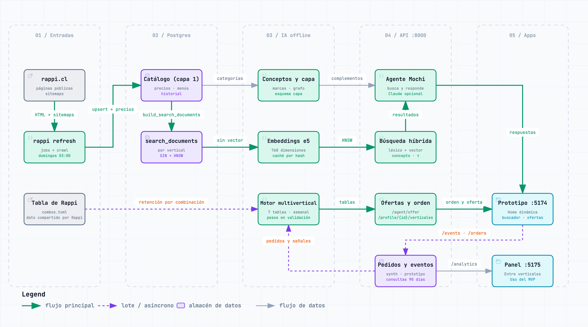
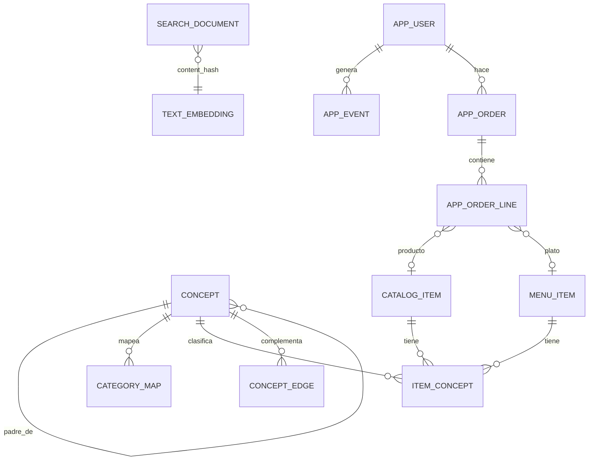

# Diseño: RAG, agente Mochi y panel para la empresa

> Cómo se conectan el catálogo (scraper), la búsqueda semántica, el agente, el prototipo y un panel de negocio. Las etapas de diseño 0–8 se construyeron hasta el 30-09-2026, y el MVP integrado se armó encima en 7 etapas (10 y 11-10-2026, §7); lo que el código todavía no cubre se marca como pendiente.
> Última actualización: 11-10-2026. Contexto: [contexto-y-problema.md](contexto-y-problema.md) · Modelo de datos: [ecosistema-rappi.md](ecosistema-rappi.md) · Resultados vigentes: [README → Resultados](../README.md#resultados).
> Diagramas: [flujo de datos por etapas](diagramas/rag-datos.png) y [vista por carriles](diagramas/arquitectura-ia.png). Sus versiones interactivas ([rag-datos.html](diagramas/rag-datos.html), [arquitectura-ia.html](diagramas/arquitectura-ia.html)) se descargan y se abren en el navegador.
> Lo marcado "datos parciales" se midió el 27-09-2026, antes de terminar la descarga completa.
> **09-10-2026:** el repo se enfocó en el prototipo final; el panel de negocio (§5 y etapa de diseño 7, `dashboard-empresa/`) quedó fuera de la propuesta; el **11-10-2026** (etapa 6 del MVP) volvió como parte del MVP, conectado a la API, con la vista «Uso del MVP» (§5).

## 0. La regla que ordena todo

**Buscar dentro del vertical; entender al usuario a través de los verticales.**

| | Dentro del vertical | A través de los verticales |
|---|---|---|
| **Qué es** | Recuperar productos, platos y tiendas | Saber qué le interesa a la persona |
| **Dónde vive** | `search_documents`, particionada por vertical, con un índice vectorial por partición | Perfil de intereses expresado en **conceptos** (capa 2), compartidos por todos los verticales |
| **Por qué** | Quien está en Licores quiere resultados de Licores: mezclar verticales baja la precisión | El problema que aborda el proyecto: visto desde fuera, lo que haces en un vertical no parece cambiar los otros |

La recomendación cruzada se arma así: interés del usuario (concepto) → **arista de complemento** (cerveza → snacks) → búsqueda **en el índice del otro vertical**. El puente entre verticales es el concepto, no el índice.

El aislamiento es una regla de búsqueda, no un límite del modelo: el silo es el problema que el prototipo busca resolver.

## 1. Cómo funciona el RAG



Versión interactiva: [diagramas/rag-datos.html](diagramas/rag-datos.html) (descargar y abrir en el navegador).

```text
OFFLINE (después de cada refresh)
catálogo (capa 1) ─┬─► documentos de búsqueda por vertical ─► embeddings de texto (e5, caché por content_hash) ─► HNSW por partición
                   └─► mapeo a conceptos (categoría → reglas → embeddings) ─► item_concepts + aristas

ONLINE (cada consulta)
texto ─► entender (intención, vertical, conceptos, filtros)
   ─► recuperar en el vertical, con filtros duros dentro de cada lista:
      léxico (tsvector) + vectorial (coseno) ─► fusión RRF ─► refuerzo por concepto
   ─► precios y stock actuales por SQL (nunca desde el embedding)
   ─► componer (plantilla o LLM, en JSON) ─► verificar ─► responder + registrar evento
```

Decisiones:

- **Documentos.** Hay uno por producto, plato o tienda, y por vertical, en la tabla `search_documents`. La arma el SQL `build_search_documents` del scraper, con nombre, marca, presentación, categoría y descripción. Todos tienen embedding; los conteos vigentes están en [README → Resultados](../README.md#resultados).
- **Sin dividir en trozos.** Son textos cortos. En los datos parciales, solo unos pocos documentos, casi todos de Mall, superaban los 2.000 caracteres; esos se truncan en 512 tokens. Por eso el nombre va primero.
- **El precio no va en el texto que se embebe.** Cambia en cada corrida y obligaría a volver a embeber. Se lee por SQL (`price_snapshots`, `menu_price_snapshots`).
- **Caché por `content_hash`.** Los vectores se guardan en una tabla propia `text_embeddings(content_hash, embedding_model, embedding)`. Así, un texto repetido en varios verticales se embebe una sola vez y se copia a `search_documents.embedding`, donde vive el HNSW de cada partición. Además, si el texto no cambió, el `refresh` conserva el vector de cada fila (`_UPSERT` en `rappi-scraper/src/rappi_scraper/storage/search.py`).
- **Rendimiento del cálculo offline.**
  - Los textos por embeber se ordenan por largo antes de armar los lotes.
  - Los índices HNSW se construyen con 1 GB de `maintenance_work_mem`, solo durante esa transacción (se ajusta con `HNSW_MAINTENANCE_WORK_MEM`, ver `rappi-ia/.env.example`).
  - El kNN de conceptos lee los vectores del caché en binario y por bloques, sin cargarlos como texto.
- **Híbrido con RRF (k = 60)** en lugar de solo vectores:
  - lo léxico acierta marcas y nombres exactos ("Heineken 470");
  - lo vectorial acierta necesidades ("algo para el carrete", "remedio para la guata").
  - El léxico usa una columna de texto sin tildes ni ñ (`unaccent` + español), en el documento y en la consulta: "panales" encuentra "pañales". Cada palabra pesa según su IDF dentro del vertical: las palabras raras pesan más.
- **Filtros duros dentro de cada recuperador, antes de fusionar.** Precio máximo, tipo de ítem y vertical:
  - el precio se compara contra `price_min`, una columna indexada con el precio vigente más bajo entre las tiendas del vertical (migración 013);
  - un precio bajo $10 cuenta como desconocido: son los $0 y $1 de relleno de los platos cuyo precio depende de las opciones. No pasa el tope ni se muestra;
  - en el vectorial, un pool de 200 candidatos con `hnsw.iterative_scan` de pgvector; si el tope de precio deja pocos documentos (hasta 5.000), se revisan todos, porque el índice filtrado podría devolver de menos.
  - Si nada de lo pedido cabe bajo el tope, no se muestra otra cosa: Mochi lo dice ("no hay bajo $X; el más barato cuesta $Y") y **no** registra demanda no satisfecha.
- **"Sin resultado" bien definido.** La búsqueda vectorial siempre devuelve vecinos, así que "no encontrar" necesita una regla.
  - **Primera condición, siempre:** que nada calce todas las palabras de la consulta.
  - **Si la consulta nombra un concepto:** además, que el concepto no tenga surtido real en el vertical, es decir, menos de 3 ítems o del 0,05% del vertical.
  - **Si no nombra ninguno:** además, que el coseno máximo de e5 quede bajo τ del vertical. Como la coincidencia estricta, se mide sin el tope de precio: lo que existe a otro precio no es demanda no satisfecha. Una consulta sin palabras que buscar (solo stopwords y palabras de saludo, cortesía o pedido, como «té» o «quiero té porfa») no se marca: la primera condición no se puede evaluar y el coseno solo no basta.
  - **Qué se muestra:** ni los vecinos del coseno ni productos de otro concepto (si el concepto pedido es testimonial, sus pocos productos sí). Sin productos a la vista, Mochi anota la demanda, salvo si se habló de síntomas: ahí los medicamentos se ocultan por la regla 6d, no por falta de surtido.
  - **Por qué no se usa solo el coseno:** en la evaluación, los cosenos de e5 se concentran en un rango estrecho (datos parciales) y separan mal; la presencia del concepto es mejor señal.
  - **Calibración:** τ se calibra por vertical con las consultas negativas del set de evaluación, pidiendo precisión ≥ 0,9. Solo cuentan las negativas que dependen de τ (sin coincidencia léxica ni concepto nombrado, y con palabras que buscar); un vertical sin ellas no recibe propuesta y conserva su τ (o 0,82 si nunca tuvo): pasarlo a 0,82 metía una falsa alarma en Mall. El reporte muestra el τ vigente y el propuesto, y advierte cuando un τ vigente está en el piso de la grilla (0,70): ahí la regla del coseno casi no se dispara.
  - **Resultado vigente:** precisión 1,00 y recall 0,71 (29 de 41) en la búsqueda (`retrieve`), en [README → Resultados](../README.md#resultados). Mochi anota 21 de las 41, sin falsas alarmas en las 124 positivas: en las otras 8 la búsqueda la marca, pero se muestran los pocos productos del concepto pedido (surtido testimonial). El set anterior (28-09) tenía negativas desactualizadas y se renovó el 29-09.
  - **Por qué no se detecta todo:** de las negativas no detectadas, unas nombran un concepto que el vertical sí tiene, otras calzan por casualidad con la regla léxica estricta («neumáticos» → un renovador de neumáticos en conveniencia) y otras quedan sobre τ. El reporte explica cada una.
  - **Límite conocido:** un iPhone en el súper no cuenta, porque hay accesorios del mismo concepto.
- **Reranker:** no por ahora. Se agrega (p. ej. `bge-reranker-v2-m3`) solo si la evaluación lo justifica, porque suma latencia y otro modelo.
- **Evaluación antes de elegir.**
  - **Set:** 124 consultas positivas en los 8 verticales y 41 negativas (al menos 5 por vertical, verificadas contra el catálogo completo), en `rappi-ia/src/rappi_ia/eval/queries.json`. Incluye consultas exactas, sin tildes y necesidades en lenguaje natural.
  - **Relevancia:** se juzga automáticamente por concepto (un resultado es relevante si su concepto está entre los esperados).
  - **Métricas:** P@10, MRR y nDCG@10, comparando léxico, vectorial, híbrido e híbrido sin refuerzo por concepto (ablación), con comparación pareada por consulta e intervalo de confianza por bootstrap. Recall@10 no se calcula.
  - **Lo que ve el usuario:** la fila «híbrido mostrado» juzga los productos que devuelve `search_products` (/search y Mochi: sin sensibles no pedidos, con foco en el concepto, precio vigente y sin repetidos). Su «sin resultado» usa la regla con que Mochi registra la demanda: la búsqueda lo marca, no se muestra ningún producto y la consulta no habla de síntomas.
  - **Resultado:** el híbrido quedó como modo por defecto. Cifras en [README → Resultados](../README.md#resultados); el reporte de cada corrida queda en `rappi-ia/data/eval/busqueda.md` y la copia que respalda las cifras, en [resultados/](resultados/).
  - **Salvedad:** el híbrido recibe un refuerzo por el mismo concepto con que se juzga la relevancia. Sin el refuerzo, 0,860 frente a 0,849 del vectorial: la diferencia no es concluyente (IC 95 % −0,015 a 0,038, [reporte del 06-10](resultados/busqueda-2026-10-06.md)).
- **Dos audiencias, un solo núcleo:**
  - Mochi, para clientes, en el prototipo;
  - más adelante, preguntas del equipo interno (Marketing, Producto, BI), que usan las mismas herramientas más consultas SQL de análisis.

## 2. Qué datos se relacionan y cuáles no

### Se relacionan

| Relación | Llave | Confianza | Uso |
|---|---|---|---|
| Producto ↔ oferta de tienda ↔ vertical | `master_product_id`, `store_id` | Exacta | Catálogo, precios y disponibilidad |
| Mismo producto en varios verticales | `master_product_id` | Exacta, pero **inflada** por tiendas con doble etiqueta (Lider, Express Lider y Unimarc aparecen como conveniencia y como súper) | Contando solo tiendas de un único vertical son 16.041 productos cruzados; la doble etiqueta los sube un 15%, a 18.450 (catálogo del 30-09). La consulta está en el repo como vista (`v_cross_vertical_items_real`), y el panel y el mapa multivertical cuentan así |
| Producto o plato ↔ concepto | `item_concepts` (mapa de categorías hecho con LLM, ajustes curados, reglas o embeddings) | Probabilística: se guardan `method`, `confidence` y `model_version` | El puente entre verticales |
| Plato de restaurante ↔ producto del súper | **Solo vía concepto** (pizza ↔ pizza congelada) | Probabilística | "Pizza hoy en restaurante o para el fin de semana del súper" |
| Marca de producto entre verticales | `trademark` normalizado | Media: solo una minoría de los productos trae marca (datos parciales) | Análisis de surtido |
| Usuario ↔ concepto | Eventos → perfil con decaimiento | Hoy simulada | Recomendaciones y panel |
| Consulta ↔ concepto ↔ vertical | Entendimiento de la consulta | Probabilística | Tendencias y demanda no satisfecha |

### No se relacionan (o no se deben mezclar)

- **Precios entre verticales** si no son el mismo `master_product_id` y la misma presentación.
- **Plato y producto por id:** no comparten llave; solo el concepto.
- **Cadenas entre verticales.** `brands` no identifica cadenas: cubre una minoría de las tiendas (datos parciales), casi siempre con una tienda por marca, y no incluye Lider ni Unimarc. Por nombre, cadenas como Unimarc, Cruz Verde u OXXO sí aparecen en 2 o 3 verticales. El nombre normalizado sirve para analizar surtido, pero no como puente de recomendación: ese puente es el concepto.
- **"No está en el catálogo" ≠ "Rappi no lo vende":** la muestra pública trae hasta 24 productos por sub-pasillo. La demanda no satisfecha es una **señal que hay que validar**, no una prueba.
- **Vectores de modelos distintos:** si algún día se suma otro modelo, vivirá en otro espacio. Nunca se comparan entre sí; se fusionan por ranking (RRF), no por puntaje.
- **Datos simulados con datos reales:** cada usuario, evento y pedido lleva `source` (`synthetic` o `prototype`). El panel los muestra marcados y nunca los suma con métricas reales.

### Privacidad

- **Consultas guardadas:** se guardan con los datos personales redactados (RUT, teléfono, correo, dirección) y se retienen 90 días. Después solo quedan agregados por concepto.
- **"Olvidar":** borra o anonimiza los eventos de ese concepto (o de todo el usuario), no solo el perfil.
- **Avisos:** "avisar cuando llegue" y los mensajes de reactivación requieren consentimiento explícito.
- **En el panel:** los usuarios aparecen con un id seudónimo. Las listas a nivel de usuario nunca incluyen conceptos sensibles.

## 3. Lógica de embeddings

| Entrada | Qué se hace | Modelo (local, sin costo por uso) | Dónde queda |
|---|---|---|---|
| **Texto** (catálogo y consultas) | Embedding con prefijos `passage:` (documentos) y `query:` (consultas y etiquetas de conceptos) | `intfloat/multilingual-e5-base` (768 dimensiones, máx. 512 tokens) | Caché `text_embeddings` → `search_documents.embedding`, con un HNSW por partición |

**Cómo se combinan:**
- Toda consulta termina en (vertical, conceptos y texto).
- Cada fuente aporta una lista ordenada (léxica y vectorial de texto) y se fusionan con RRF.
- Cada vector guarda su `embedding_model`.

**¿Por qué modelos locales?** No requieren claves de API, los datos no salen del equipo y no tienen costo por uso. Se pueden cambiar sin rehacer el diseño: el caché se separa por modelo.

## 4. Comportamiento del agente (Mochi)

Mochi es el nombre que ve el usuario (antes, Bigotes). El código usa nombres neutros porque el nombre puede cambiar: `rappi_ia/agent/rappi_agent.py` y la clase `RappiAgent`; el nombre visible sale de `config.AGENT_NAME` (variable de entorno `AGENT_NAME`, por defecto «Mochi»). El agente responde solo por texto (`POST /agent/ask`); sus ofertas salen de `POST /agent/offer` y `GET /agent/plans`.

**Flujo por turno:** entender → decidir herramienta(s) → recuperar → componer → verificar → registrar.

**Herramientas** (en `rappi-ia/src/rappi_ia/agent/`):
- `buscar_productos(vertical, consulta, conceptos, precio_max)`: `search_products` en `tools.py`
- `recomendar_complementos(conceptos, vertical_actual)`: `suggest_complement` en `tools.py`
- `buscar_remedios(sintoma)`: `search_remedies` en `tools.py` (remedios sin receta que nombran el síntoma)
- **Servicios sin catálogo** (`[[service]]` en `taxonomy.toml`): RappiTravel (viajes, vuelos, hoteles) y RappiFavor (envíos, compras en cualquier tienda, trámites). Si la consulta los nombra y no nombra un producto, Mochi lleva a su pantalla y, en el prototipo final (`mode=propuesta` en la API), sugiere un gancho del catálogo (RappiTravel: protector solar, traje de baño o maleta). Lo que no está en el catálogo se ofrece con RappiFavor.
- `detalle(entidad)`: pendiente
- `historial_precio(producto)`: pendiente

**Reglas de conducta:**

1. **Solo habla de lo que existe.**
   - Cada producto citado viene de una herramienta, y los precios salen de SQL.
   - El LLM recibe solo campos de una lista blanca: id, nombre, marca, presentación y precio.
   - Las descripciones de los comercios van delimitadas y marcadas como datos, nunca como instrucciones.
   - En el texto, los productos se citan con marcadores (`{p1}`) que reemplaza el código.
   - El verificador rechaza ids no recuperados y cifras, precios o atributos ("sin alcohol", "el más barato") que no salgan de esos campos.
   - Los botones (`actions`) los arma siempre el código.
2. **Respeta el vertical en que estás.** La respuesta principal sale de ese vertical. Lo cruzado va aparte y marcado con su vertical ("De Licores"), con su razón visible ("porque llevas cerveza") y un botón para abrir esa vertical.
3. **Máximo una sugerencia cruzada por respuesta** y una por tema por sesión (el tope diario queda pendiente). Nada de urgencias falsas.
4. **Honestidad.** Si no encuentra (según la definición del §1), lo dice y registra **demanda no satisfecha** (consulta, vertical, conceptos y condición). Esa es la materia prima de las oportunidades de negocio.
5. **Aclara, no adivina.** Si la intención es ambigua entre verticales, hace una sola pregunta con opciones.
6. **Categorías sensibles y restringidas.**
   - a. **Sensibles:** los conceptos marcados `sensitive` (medicamentos, salud sexual, bienestar sexual, tabaco y vapeo). **Restringidos por edad:** alcohol, tabaco, vapeo y adultos. Un producto es restringido si `is_alcoholic` o `age_restricted` es verdadero, o si su concepto es `age_restricted`.
   - b. **Nunca por iniciativa propia.** Mochi no sugiere un producto sensible, ni como sugerencia cruzada, recompra, reactivación o alerta. Las aristas hacia esos conceptos se ignoran. ~~El alcohol se puede sugerir como complemento (cerveza con pizza), siempre con +18.~~ **Reemplazada el 10-10-2026** (etapa 3 del MVP, ver [decisiones.md](decisiones.md)): Mochi tampoco propone por su cuenta alcohol (ni la vertical Licores), farmacia, bebé ni salud, aunque el carrito tenga cerveza o pañales. Solo el kit de una ocasión que la persona eligió puede traer alcohol, siempre con +18.
   - c. **Fuera del perfil.** Los conceptos sensibles no entran al perfil, no se muestran en "Aprendiendo de ti" y no sirven de origen ni de razón de una sugerencia.
   - d. **Síntomas.** Quien habla de un síntoma («tengo fiebre», «me siento mal») va a Farmacia con remedios **sin receta** cuyo texto nombra el síntoma (búsqueda por palabras), o con analgésicos si nada lo nombra; nunca un medicamento con receta (`requires_medical_prescription` de Rappi). Sin venta cruzada ni «También en». Si la farmacia no tiene nada, se muestra lo de cuidarse (sopas, jugos, té). No hay aviso aparte: cortaba la compra.
   - e. **Productos +18.** Siempre llevan el recordatorio. El tabaco y el vapeo solo se muestran si se piden por nombre, porque en Chile su publicidad está prohibida (Ley 20.105).
7. **Memoria transparente.** Intereses por concepto con decaimiento (vida media de 14 días), visibles ("Aprendiendo de ti") y borrables ("Olvidar"). En modo "Rappi hoy" no aprende.
8. **El código decide y el LLM solo redacta.**
   - Sin clave de API, Mochi responde con plantillas y las mismas reglas. Con `ANTHROPIC_API_KEY`, Claude redacta el texto en JSON estricto sobre lo recuperado.
   - Entender la consulta: hoy son reglas + embeddings, y así sigue en vivo.
   - **Jev** (el modelo "System One" de TypeSafe: juicios tipados con probabilidad y baja latencia) es una ayuda **opcional y fuera de línea**, solo dentro de `make post-refresh` (etapa 7 del MVP; guía en [jev.md](jev.md)): etiqueta con concepto las categorías nuevas del catálogo (`make jev-categorias`; un concepto sensible o +18 nunca se asigna solo, va a revisión humana) y es un tercer juez de la búsqueda en `make eval`, junto al juez por concepto y las personas. Nunca corre en la API ni reordena resultados; solo ve datos públicos del catálogo y las consultas de evaluación. Está construido y apagado: se activa con `TYPESAFE_API_KEY` y un piloto aprobado contra planillas juzgadas a mano (`eval/jev-adopcion.json`); sin ellos el proceso es el de siempre.

**Contrato de respuesta** (`text`, `products`, `stores`, `reason`, `actions` y `tags`; el cerebro local `brain.js` que lo originó ya no existe: la app solo lee la API):
- `reason` sigue en el primer nivel;
- `products` tiene la forma que el cliente muestra (`id`, `name`, `price`, `img`, `store`…; el catálogo transcrito `data/catalog.js` ya no existe);
- `suggestion` agrega la sugerencia cruzada, que el cliente muestra como "De Licores" (su vertical) con un botón "Ver más en Licores";
- `also_in` (opcional) lista hasta 3 verticales más donde hay lo pedido, con dos tiendas cada una (nombre y logo); el cliente la muestra como "También en". No es una sugerencia: no cuenta para el máximo de una por respuesta;
- `vertical` usa los códigos del backend. El cliente los traduce a los ids del prototipo: supermercado → grocery, licores → liquor, farmacia → pharmacy, mall → retail, conveniencia/turbo → express, chocolateria → chocolates.

```json
{ "text": "…", "products": [], "stores": [], "reason": "Porque llevas 🍺 cerveza",
  "suggestion": { "reason": "Porque llevas 🍺 cerveza", "vertical": "supermercado", "concept": "snacks-salados", "products": [] },
  "actions": [], "intent": { "kind": "buscar", "vertical": "licores", "concepts": ["cerveza"], "confidence": 0.82 },
  "tags": ["cerveza"], "unmet": false, "age_notice": true }
```

### Perfiles de gusto

Quien pide seguido lo mismo recibe un perfil («🥢 Amante de lo asiático») y, con él, ofertas de ese gusto en otras verticales, de a un peldaño. La demo parte con algo simple, el sushi; el carrete es un perfil más, secundario y sin alcohol. Diseño y lo que cambió al construirlo: [especificación](superpowers/specs/2026-10-14-perfiles-de-gusto-design.md).

- **Son datos, no código.** Cada perfil es un `[[perfil]]` de `rappi_ia/offers/perfiles.toml` (nombre, emoji, el «gusto» que dice Mochi, segmentos que lo activan, escalera y un viaje opcional) y sus viajes, «Idea para RappiTravel» con 2 datos verificables y su fuente, están en `destinos.toml`. `offers/profiles.py` los valida al cargar: los conceptos, verticales y segmentos existen y ningún peldaño nombra algo que las guardias rechacen. Hay cinco: asiático (el principal), café, italiano, mascotas y carrete; agregar otro es escribir datos.
- **Cómo se activa.** Por los segmentos de la capa de datos ([capa-de-datos.md](capa-de-datos.md)): la persona tiene el perfil si algún segmento suyo, de los del perfil, llega al nivel mínimo (`medio`). Solo para personas del prototipo; los simulados no tienen perfil. El «por qué» se cuenta con lo que pidió y buscó en los últimos 120 días («Pediste 🍣 sushi 2 veces…»), y «Olvidar» borra los segmentos, así que el perfil desaparece.
- **La escalera.** Peldaños de lo más cercano a lo más lejano (el asiático: restaurantes, Turbo, Express, Súper y chocolatería). Cada uno busca en su vertical los productos de sus conceptos, hasta 4, y se salta si no hay ninguno; con menos de 2 peldaños no hay oferta. En restaurantes va un plato por cadena y deja fuera las cadenas donde la persona ya pidió; ningún nombre se repite entre peldaños y no se muestran tiendas de licores. Mochi ofrece de a un peldaño, con su «¿Por qué?» y «Olvidar».
- **Guardias.** Valen las de siempre (`offers/guards.py`): nada de alcohol, +18, Farmacia, bebé, salud ni sensible por iniciativa de Mochi, ni tiendas Sex shop o Smoking shop. Por eso el carrete no nombra alcohol. Desde el 14-10 la guardia de alcohol también mira el nombre del producto y del plato, porque la marca de la tienda puede estar mal ([decisiones.md](decisiones.md)).
- **API.** `GET /profile/{user_id}/gustos` (con la identidad firmada) devuelve `{"perfiles": [{id, nombre, emoji, nivel, principal, por_que, basis}]}`, o la lista vacía. `POST /agent/offer` con `moment: "perfil"` y `context: {"perfil": <id>}` devuelve la escalera, el viaje y el `reason`; sin `perfil` usa el primero que la persona tiene, y con `perfil` y sin `user_id` entrega la escalera sin «por qué» personal. Responde 204 si no hay perfil ni escalera y 422 con un id desconocido. El panel cuenta estas ofertas como el momento «Perfil de gusto» (`agent-perfil`).
- **Estado.** El backend está; la app todavía no lo usa (sus ejemplos viven en `prototipo-app/src/api/fixtures/`). En la base real hace falta `rappi-ia concepts` y `make layers` tras fusionar: sin ellos, los conceptos asiáticos nuevos no tienen productos.

## 5. Panel para la empresa: ¿vale la pena?

> Desde el 11-10-2026 es parte del MVP (`dashboard-empresa/`): `make mvp` lo levanta junto a la app y lee la API. Los datos simulados siguen mostrando solo la mecánica; lo que la gente hace en la app se ve aparte, en «Uso del MVP».

**Sí, si se enfoca en decisiones y no en gráficos.** Las preguntas al agente y las búsquedas son una encuesta continua de lo que la gente quiere. El panel convierte eso, junto con la conducta de compra, en acciones para **subir la frecuencia y bajar el abandono**.

**Métricas** (definidas en SQL en `rappi-ia/src/rappi_ia/analytics/queries.py`):

| Métrica | Definición |
|---|---|
| Usuario activo | Al menos una sesión en los últimos 30 días |
| Frecuencia | Pedidos / usuarios activos (30 días). Días entre pedidos: mediana por usuario y luego mediana entre usuarios |
| Abandono de carrito | Carros (`cart_id`) con al menos un producto, cuyo último evento de carro fue hace más de 24 h y sin pedido, sobre todos los carros con productos. Se cuenta una vez por carro |
| Abandono de búsqueda | Búsquedas sin clic ni agregado al carro y sin otra búsqueda con clic en 2 minutos, sobre el total de búsquedas |
| Ritmo del usuario | Mediana de los intervalos entre pedidos en 180 días. Con solo 2 pedidos, el único intervalo, acotado entre 7 y 30 días |
| En riesgo / perdido | En riesgo: días desde el último pedido > máx(2 × ritmo, 21). Perdido: > máx(3 × ritmo, 45). Los usuarios con 1 compra van aparte ("sin segunda compra"): un carro dividido en dos verticales son dos pedidos, pero una sola compra |
| Retención | Hizo al menos un pedido entre los días 61 y 120 desde su primer pedido |
| Usuarios multi-vertical | Pidieron en 2 o más verticales en 60 días. Su retención se compara **a igual número de compras (carros) y antigüedad**: quien pide más cae más en dos verticales y además retiene más, así que la comparación directa no mide el efecto |
| Sugerencia aceptada / convertida | Aceptada: el producto sugerido (al preguntarle al agente o en "Para ti") se agregó al carro; cuenta una vez por sugerencia (concepto, vertical y origen) en la pestaña, igual que la mostrada, así las aceptadas nunca superan a las mostradas: quitarlo y volver a agregarlo, o agregarlo otra vez en el carro siguiente, no es otra aceptación. Convertida: llegó a un pedido. El aviso sobre el carro se mide aparte: ahí aceptar es abrir al agente |
| Servicios sin catálogo | Por servicio (RappiTravel, RappiFavor): veces que Mochi lo ofreció (`service_shown`), que se abrió (`service_opened`) y ganchos del catálogo mostrados y aceptados (sugerencias con `origen` = el servicio). Vista «Entre verticales» |
| Ofertas del agente por momento | Sugerencias mostradas (`suggestion_shown`) y aceptadas (`suggestion_accepted`) agrupadas por el momento que dice su `origen`: `agent-plan`, `agent-carrito`, `agent-checkout`, `agent-proximo_pedido`, `agent-sin_resultado`, `agent-vertical_por_probar`, `agent-perfil`, la pregunta al agente (`agent-ask`) y «Para ti». Los nombres históricos (`mochi-<momento>`, `chat`, `para-ti-local`, `vertical-para-ti`) siguen contando; un origen sin momento o desconocido va a «sin momento» y no se pierde. Quedan fuera los servicios sin catálogo (tienen su sección) y el aviso sobre el carro. La tasa de aceptación necesita 10 mostradas, como en las sugerencias cruzadas. Solo cuentas y personas distintas |
| Búsquedas sin resultado | De las búsquedas (`search`) y preguntas al agente (`ask`, antes `chat`) que saben si encontraron algo, cuántas no y, por vertical y concepto reconocido, cuántas sin resultado (hasta 20 filas). **Nunca el texto buscado**; sin concepto reconocido se rotula «Sin concepto reconocido» y los conceptos sensibles no se muestran. Una fila sin umbral de personas puede reflejar la búsqueda de una sola persona: por eso se lee como demanda que el catálogo no cubre, no como una tendencia |
| Embudo por vertical | Sesiones que buscan (llegan a la vertical) → agregan al carro → inician pago → piden. La entrada (buscar, preguntarle al agente, navegar, aceptar una sugerencia o agregar al carro desde una lista, que solo manda el agregado) se mira en toda la sesión, porque la sugerencia cruzada lleva el pedido a otra vertical. Una sesión cuenta en una vertical si tuvo ahí algún evento que no sea ver o descartar una sugerencia: ver una sugerencia sin aceptarla no la mete en esa vertical. Por eso una sesión puede contar en dos verticales: la conversión global (el titular) cuenta cada sesión una vez |

**Vistas** (además de una pestaña Resumen con los indicadores y las palancas):

1. **Oportunidades.**
   - Demanda no satisfecha, agrupada por concepto, vertical y ciudad: cuántos usuarios la piden, su tendencia y una acción sugerida (sumar comercios o categoría, sinónimo de búsqueda, o avisar cuando llegue). «Que Mochi lo ofrezca en otra vertical» solo se sugiere donde el agente lo haría: la misma regla de `available_elsewhere`.
   - Conceptos que suben: últimas 4 semanas contra las 4 anteriores.
2. **Frecuencia y abandono.** Embudo por vertical, retención por cohorte semanal, distribución de días entre pedidos y lista de usuarios en riesgo (id seudónimo) con la acción sugerida.
3. **Entre verticales.** Afinidad concepto → concepto y rendimiento de las sugerencias de Mochi (mostradas, aceptadas, convertidas, ignoradas).
4. **Catálogo (muestra pública real).** Cobertura (obtenidos / declarados) por vertical y concepto, calidad (sin imagen o sin categoría) y cambios de precio. La comparación surtido vs. demanda va aparte, marcada "demanda simulada".

**Aristas aprendidas** (alimentan al agente con `method = 'coocurrencia'`):
- Usan la confianza dirigida P(B | A). El lift > 1 es solo un filtro: el lift es simétrico y no da dirección.
- Requieren al menos 30 usuarios distintos con A y B. Suavizarlas hacia la arista curada queda pendiente: hoy su peso es la confianza P(B | A).
- No cuentan co-ocurrencias en que B se agregó desde una sugerencia de Mochi, para no retroalimentarse.
- Las aprendidas de datos `synthetic` quedan marcadas y **el agente no las usa**: solo se ven en el panel.
- Nunca se aprenden aristas hacia conceptos sensibles.
- **Desde el 16-10-2026, el motor multivertical sí usa patrones de la población** (`rappi_ia/motor/`): transiciones entre verticales, tendencias y compra cruzada ordenan qué vertical ofrecer. Eso no cambia las aristas de arriba (`capa.knowledge_edges` sigue sin lo aprendido de `synthetic`), pero sí que, mientras `MOTOR_POBLACION` sea `synthetic`, parte de lo que se recomienda sale de patrones simulados. Se declara así, cada tabla del motor lleva su `data_source` y las dos fuentes no se mezclan. Ver [capa-de-datos.md](capa-de-datos.md#motor-multivertical) y la decisión del 16-10-2026 en [decisiones.md](decisiones.md#datos-simulados-y-panel).

**Palancas que salen de estos datos:**

| Palanca | Señal | Acción | Métrica que mueve |
|---|---|---|---|
| Recompra por ciclo | Días entre compras del mismo concepto (pañales, café, alimento de mascota) | "¿Repetimos?" en el momento justo. **Implementada** (16-10-2026): el momento `recompra` de `POST /agent/offer` (`offers/engine.py`) ofrece «¿Repetimos …? Lo pides cada N días.» cuando toca, según la tabla `replenishment` del motor; la Home la muestra después de los accesos, con «Ver producto». La oferta se cuenta como aceptada al agregar el producto al carro, no al tocar el botón; el panel la lista como «Recompra» en «Uso del MVP» | Frecuencia |
| Rescate de carrito | Carro abandonado | Recordatorio con el carro y un complemento. Sin descuento automático | Abandono de carrito |
| Reactivación por ritmo | Usuario en riesgo según su propio ritmo | Mensaje con su concepto top y una novedad del vertical (con consentimiento) | Abandono (churn) |
| Segunda vertical | Usuario de un solo vertical | Sugerencia cruzada de mayor confianza. **Implementada** (16-10-2026): el momento `vertical_por_probar` sigue la escalera de combinaciones (`motor/predict.py`, `target_step`: el grupo que más sube la retención esperada, con la tabla de Rappi mezclada con `combo_stats`). Dentro de la vertical ofrece una compra cruzada («Para tu pedido de …: … en …», o «También hay … en …» si la regla va del concepto a sí mismo; sin artículos ni verbos que deban concordar con conceptos plurales o compuestos), lo más pedido («Lo más pedido en …»; si una regla eligió los productos sin poder nombrar su origen, «Para sumar en …») o, si ya pidió ahí hace más de un mes, «Vuelve a …»; el complemento del carro (`suggest_complement`) usa el mismo paso para desempatar, pero la marca que la persona compra gana a la combinación. Todas dicen por qué. La corrección causal sigue pendiente: solo un grupo de control la mide | % multi-vertical y retención |
| Ocasiones | Picos por día u hora (viernes: carrete; domingo: asado) | Campañas con horario | Frecuencia |
| Demanda no satisfecha | Consultas sin resultado | Captar comercios o categorías; avisar a quien lo pidió (con consentimiento) | Conversión y oportunidades |
| Búsquedas fallidas | Reformulaciones sin clic | Sinónimos y mapeo de conceptos | Abandono de búsqueda |
| Bajas de precio | `price_snapshots` real, sobre productos que el usuario compra | Alerta de precio | Frecuencia |

Ninguna palanca usa conceptos sensibles.

**Límites honestos:**

- **Uso del MVP.** Lo que ve la vista «Uso del MVP» (fuente `prototype`) es lo que hicieron pocas personas probando la app: se rotula «uso del MVP, pocas personas: no es evidencia» y nunca se mezcla con lo simulado. «Olvidar» en la app borra los eventos de esa persona, así que también salen de estas cuentas.
- Hoy los usuarios, eventos y pedidos son **simulados**: los genera `events/synth.py` (3.000 usuarios × 26 semanas, semilla 7; `source = 'synthetic'`), con supuestos explícitos. Por ejemplo, el generador asume que quien usa más verticales abandona menos. El panel **muestra la mecánica, no evidencia**: con datos reales, esa relación se mide y puede no cumplirse. La pestaña Catálogo es la única que usa datos reales.
- Cualquier palanca se valida con un grupo de control (A/B con *holdout*) antes de escalar. El efecto causal de "Segunda vertical" se mide solo así, no con la comparación de retención.

## 6. Modelo de datos nuevo



Notas del modelo:

- **Platos y productos:** no hay una tabla de platos estándar. Un plato y un producto del súper se conectan al compartir concepto en `item_concepts`.
- **Eventos:** `APP_EVENT` lleva `session_id` (una sesión termina tras 30 minutos sin actividad) y `cart_id` en los eventos de carro (`cart_add`, `cart_remove`, `checkout_start`, `order_placed`).
- **Líneas de pedido:** `APP_ORDER_LINE` puede apuntar a un producto o a un plato.
- **Precio vigente:** `latest_prices` y `latest_menu_prices` guardan el último precio de cada oferta y de cada plato (migración 032), y `v_latest_offers` es la única definición de oferta vigente.
- **Jev:** `eval_judgments` guarda los juicios de Jev (migración 030), y el mapa de categorías suma el método `jev`.
- **Motor multivertical:** siete tablas (migración 036): `user_vertical_affinity` y `replenishment` por persona (se van con «Olvidar»), y `vertical_transitions`, `combo_stats`, `combo_steps`, `cross_sell_rules` y `trends` por población, con `data_source` (`synthetic` o `prototype`). No están en el diagrama: dependen de `app_users`, `app_orders` y `concepts`. Cada una tiene su vista en `capa` ([capa-de-datos.md](capa-de-datos.md#motor-multivertical)).
- **Capa de datos:** las vistas estables para otras herramientas están en el esquema `capa` ([capa-de-datos.md](capa-de-datos.md)).
- **Tabla sin uso:** `image_embeddings` (de una versión anterior) sigue en la base, sin que nada la escriba ni la lea; una migración para borrarla se dejó fuera para no tocar el historial.
- **Procedencia:** todo dato inferido guarda `method` (`curado`, `llm`, `regla`, `embedding`, `coocurrencia`), `confidence`, `model_version` y fecha. Los datos de usuario guardan `source`.
- **H3:** queda para después, porque no lo necesita ninguna vista de este plan.

## 7. Etapas

| Etapa | Entrega | QA | Estado |
|---|---|---|---|
| 0. Diseño | Este documento, los diagramas y docs sin contradicciones | Validación Archify y revisión adversarial | Hecha |
| 1. Conceptos (capa 2) | `concepts`, `category_map`, `item_concepts`, `concept_edges` y `rappi-ia concepts` | Cobertura ≥ 85% y precisión revisada por muestreo | Hecha |
| 2. Embeddings y búsqueda híbrida | `embed-text`, `retrieve()` y set de evaluación | P@10, MRR y nDCG@10 (Recall@10 no se calcula): léxico vs vectorial vs híbrido; calibración de τ | Hecha |
| 3. Agente | Mochi en el backend (solo texto) | Tests de reglas de conducta y escenarios | Hecha |
| 4. API | FastAPI | Tests de endpoints | Hecha |
| 5. Eventos y analítica | Tablas, generador simulado y consultas | Tests con datos controlados | Hecha |
| 6. Prototipo conectado | Cliente API con respaldo local (salió en la etapa 3 del MVP: hoy la app exige la API), eventos y bugs corregidos | Vitest y prueba en el navegador | Hecha |
| 7. Panel empresa | `dashboard-empresa/` (parte del MVP) | Vitest y chequeo visual | Hecha |
| 8. Cierre | CI (4 jobs), docs y corrida completa post-refresh | CI en verde | Hecha (30-09-2026) |

**Revisión:** tres pasadas de revisión adversarial automatizada (agentes de IA) con 66 hallazgos corregidos (27-09-2026) y una auditoría el 28-09-2026, cuyos 4 bloques de mejoras se aplicaron el 29 y 30-09. Resultados de cobertura, precisión y búsqueda en [README → Resultados](../README.md#resultados).

### Etapas del MVP (10–11-10-2026)

El MVP integrado se armó encima de las etapas de diseño en 7 etapas, cada una con su plan. La [especificación del MVP](superpowers/specs/2026-10-10-mvp-integrado-design.md) dice qué es el producto completo.

| Etapa del MVP | Entrega | Plan |
|---|---|---|
| 1. Base | `make mvp` levanta API, app y panel; `make mvp-check` los recorre con Chrome | [etapa 1](superpowers/plans/2026-10-10-mvp-etapa-1-base.md) |
| 2. Catálogo real | Las pantallas de catálogo leen la base (`/catalog`) | [etapa 2](superpowers/plans/2026-10-10-mvp-etapa-2-catalogo.md) |
| 3. Buscador y agente sobre el RAG | El buscador con Mochi y sus ofertas salen de la API (`/agent`) | [etapa 3](superpowers/plans/2026-10-10-mvp-etapa-3-mochi.md) |
| 4. Juego en el RAG (historia) | Tarjetas, desafíos y progreso en la base; salió del proyecto el 16-10-2026 (migración 035, ver [decisiones.md](decisiones.md)) | [etapa 4](superpowers/plans/2026-10-10-mvp-etapa-4-juego.md) |
| 5. Personalización | Lo aprendido, «Para ti» y eventos del prototipo | [etapa 5](superpowers/plans/2026-10-10-mvp-etapa-5-personalizacion.md) |
| 6. Panel conectado | «Uso del MVP» con lo que la gente hace en la app | [etapa 6](superpowers/plans/2026-10-11-mvp-etapa-6-panel.md) |
| 7. Jev | Etiquetas de categorías y juez de la búsqueda, listo y apagado hasta el piloto | [etapa 7](superpowers/plans/2026-10-11-mvp-etapa-7-jev.md) |

Después: la [revisión integral](superpowers/plans/2026-10-11-revision-integral.md) (11-10-2026, decisiones en [decisiones.md](decisiones.md#operación)) y, a continuación, la [etapa de calidad y despliegue](superpowers/plans/2026-10-11-calidad-y-despliegue.md).
